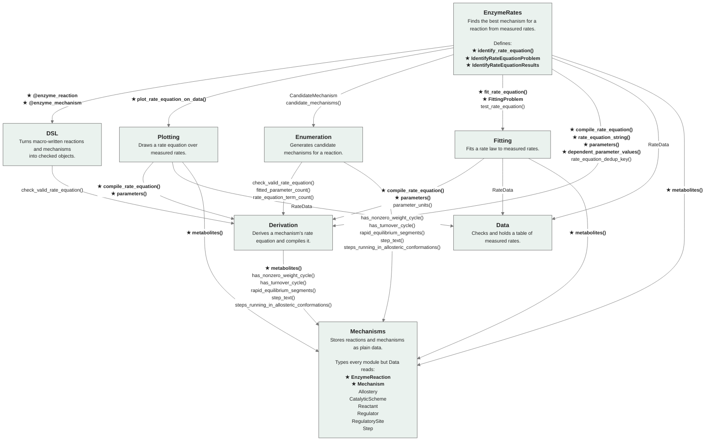

# Developer / Architecture

This page describes how EnzymeRates works inside, for maintainers; the [API Reference](@ref)
lists the exported names. A mechanism is a plain value, `Mechanism`, everywhere; only its
compiled rate law has a type of its own (see [Derivation architecture](@ref)).

## Modules

EnzymeRates is seven submodules and a top level. Each submodule lives in `src/<Module>/`:
`<Module>.jl` declares the module, includes its files and lists its interface in a `public`
statement. A module's public names are its interface to the other modules; only the exports
are promised to users. Its tests live in `test/<Module>/`, a file `test_<file>.jl` for each
source file `<file>.jl`. The diagram below shows every exported name and every name one
module takes from another, and the tables list every module's public names;
`test/test_boundaries.jl` fails when they disagree with `src/`. The diagram is generated:
each box's sentence is the first sentence of its module's docstring, and
`julia test/update_module_map.jl` rewrites it, together with the table of modules in
`.claude/CLAUDE.md`, which the same test checks.

### The module map



★ bold: exported by EnzymeRates. Arrows carry every name one module takes from another;
the Mechanisms types are listed in its box.

An arrow points from a module to a module whose names it uses. A submodule names only the
modules its arrows reach; `Mechanisms` and `Data` name none. Inside a module, code calls
its own names bare; a call into another module is qualified:
`Derivation.check_valid_rate_equation(m)`.

### What each module does

**`Data`** checks a rate table once and holds it. A `RateData` keeps the table's columns
with `Keq`, the `absolute` flag and the reference anchors; `FittingProblem` and
`IdentifyRateEquationProblem` each hold one. `Data` hides the column and anchor checks.

**`Mechanisms`** is the data model. It holds reactions (`EnzymeReaction`) and mechanisms
(`Mechanism`: a `CatalyticScheme` and its `Allostery`) as plain values whose fields any
module reads with dots. Its constructors put a mechanism in canonical form and check it,
and `show` prints a mechanism as the macro block that builds it. It hides canonical form
and the representation checks. A mechanism stores its graph and nothing derived from it;
`Mechanisms` answers the graph analyses that two modules read: the steps each
conformation runs, rapid-equilibrium segments, turnover cycles and cycles of nonzero
weight.

**`Derivation`** turns a mechanism into its rate law. It decides whether the law is
defined (the guard), solves the thermodynamic constraints, names the parameters, and
derives the law with its generated code, printed text and key. It hides the King–Altman/Cha
engine, the polynomials, the joint solve and a memo that derives each mechanism once for
several questions.

**`Fitting`** fits a rate law to data. It hides the loss, the multi-start restarts, the
scaling to the reference and the call into Optimization.jl.

**`Enumeration`** proposes candidate mechanisms for a reaction (`candidate_mechanisms`):
the starting candidates identify fits first, and the children of each candidate it keeps,
each within identify's two size limits. It hides the seeds, the expansion moves, the
structural filters that prune the search and the check of the reaction's names.

**`DSL`** reads the macro language: `@enzyme_reaction`, `@enzyme_mechanism`, which
writes plain and allosteric mechanisms alike, and `parse_mechanism`, which reads a
mechanism's printed text back. It hides the parser. `@enzyme_mechanism` runs the guard,
so the DSL cannot live in `Mechanisms`.

**`Plotting`** draws a rate equation over the rates it was fitted to, with
`plot_rate_equation_on_data`. It hides the preparation of each panel: the choice of x
axis, the series, the curves and their scaling, and the labels. The package extension
`ext/EnzymeRatesMakieExt.jl`, which Julia loads with Makie, draws the panels, so loading
EnzymeRates alone never loads Makie. The extension defines
`draw_rate_equation_panels(panels; columns, figure, axis)`, which
`plot_rate_equation_on_data` calls through `Base.get_extension` with the panels it prepared.

**The top level** (`src/EnzymeRates.jl`, `src/identify_rate_equation.jl`) holds
`identify_rate_equation` and the exports. It hides the beam search, the one fit per rate
law, cross-validation and the CSV output.

### Module docstrings

The first sentence of a module's docstring is the sentence in its box of the diagram.

```@docs
EnzymeRates
EnzymeRates.Data
EnzymeRates.Mechanisms
EnzymeRates.Derivation
EnzymeRates.Fitting
EnzymeRates.Enumeration
EnzymeRates.DSL
EnzymeRates.Plotting
```

### Interfaces

Each table lists a module's public names; the top level's lists the names it defines and
exports. "Used by" names the modules that call each name, and ✓ marks a name that
`using EnzymeRates` brings in. The tests call more.

**`Data`**

| Name | What it does | Used by | Exported |
|:-----|:-------------|:--------|:---------|
| `RateData` | A checked rate table with `Keq` and its anchors | Fitting, Plotting, top level | |

**`Mechanisms`**

| Name | What it does | Used by | Exported |
|:-----|:-------------|:--------|:---------|
| `EnzymeReaction` | A reaction and its regulators | DSL, Enumeration, top level | ✓ |
| `Reactant` | A substrate or product with its atoms | DSL | |
| `Regulator` | A declared regulator with its kind and effect | DSL | |
| `Mechanism` | A catalytic scheme and its allostery, in | DSL, Derivation, | ✓ |
| | canonical form | Enumeration, Fitting, | |
| | | Plotting, top level | |
| `CatalyticScheme` | A reaction graph: metabolites, forms and steps | DSL, Derivation, | |
| | | Enumeration | |
| `Allostery` | A mechanism's allosteric states, its oligomeric | DSL, Derivation, | |
| | state and its sites | Enumeration | |
| `Step` | A step between two enzyme forms | DSL, Derivation, Enumeration | |
| `RegulatorySite` | A regulatory site | DSL, Derivation, Enumeration | |
| `metabolites` | The rate law's concentration names | Derivation, Fitting, | ✓ |
| | | Plotting, top level | |
| `step_text` | A step as the macro writes it: `E + A ⇌ EA` | Derivation, Enumeration | |
| `steps_running_in_allosteric_conformations` | The steps each conformation runs | Derivation, Enumeration | |
| `rapid_equilibrium_segments` | The rapid-equilibrium segments of a set of steps, and the | Derivation, Enumeration | |
| | steady-state steps between them | | |
| `has_turnover_cycle` | Whether a cycle of steps turns the reaction over | Derivation, Enumeration | |
| `has_nonzero_weight_cycle` | Whether the steps a mask keeps close a cycle whose weights do | Derivation, Enumeration | |
| | not sum to zero | | |

**`Derivation`**

| Name | What it does | Used by | Exported |
|:-----|:-------------|:--------|:---------|
| `compile_rate_equation` | The rate law as a function, allocation-free per call | Fitting, Plotting, top level | ✓ |
| `rate_equation_string` | The rate law as text | top level | ✓ |
| `parameters` | The names of the constants a fit estimates | Fitting, Plotting, top level | ✓ |
| `dependent_parameter_values` | The dependent constants' values from the fitted ones and `Keq` | top level | ✓ |
| `parameter_units` | Each fitted constant's units, as powers of the rate and concentrations | Fitting | |
| `check_valid_rate_equation` | Whether the law is defined | DSL, Enumeration | |
| `fitted_parameter_count` | The number of fitted constants, from the joint solve | Enumeration | |
| `rate_equation_term_count` | The law's term count, V×τ, before derivation | Enumeration | |
| `rate_equation_dedup_key` | The law's key: one key, one fit | top level | |

**`Fitting`**

| Name | What it does | Used by | Exported |
|:-----|:-------------|:--------|:---------|
| `FittingProblem` | A mechanism, its compiled rate law and its `RateData` | top level | ✓ |
| `fit_rate_equation` | Fits a problem with an optimizer | top level | ✓ |
| `test_rate_equation` | The loss of given parameters on a rate table | top level | |

**`Enumeration`**

| Name | What it does | Used by | Exported |
|:-----|:-------------|:--------|:---------|
| `CandidateMechanism` | A mechanism the enumerator proposes, read as `c.mechanism` | top level | |
| `candidate_mechanisms` | The starting candidates of a reaction, or a candidate's children | top level | |

**`DSL`**

| Name | What it does | Used by | Exported |
|:-----|:-------------|:--------|:---------|
| `@enzyme_reaction` | Builds an `EnzymeReaction` | top level | ✓ |
| `@enzyme_mechanism` | Builds and checks a mechanism, plain or allosteric | top level | ✓ |
| `parse_mechanism` | Reads a mechanism's printed text back | | |

**`Plotting`**

| Name | What it does | Used by | Exported |
|:-----|:-------------|:--------|:---------|
| `plot_rate_equation_on_data` | Draws a rate equation over its data, a panel per group | top level | ✓ |

**The top level**

| Name | What it does | Used by | Exported |
|:-----|:-------------|:--------|:---------|
| `IdentifyRateEquationProblem` | A reaction with its checked `RateData` | | ✓ |
| `IdentifyRateEquationResults` | The selected mechanism and the CV table | | ✓ |
| `identify_rate_equation` | Searches mechanisms, selects one by CV | | ✓ |

### The mechanism data model

Stored data is read with dots; derived data is a function. A catalytic scheme is a list
of metabolite names, a list of enzyme-form names and a list of steps. A metabolite, a form
or a step is an integer index into `c.metabolites`, `c.enzyme_forms` or `c.steps`, and a
set of steps is a `BitVector` over `c.steps`. Code reads `m.catalytic.enzyme_forms[f]`,
`m.catalytic.steps[k].from` or `m.allosteric.allosteric_states[g]` directly, and calls a
function only for a fact the fields do not store, such as `step_text(m.catalytic, k)`. A
mechanism holds no reaction, and `==` and `hash` read its fields alone, alike in every
process.

| Type | Field | Holds |
|:-----|:------|:------|
| `Step` | `from::Int`, `to::Int` | its two forms, in its stored direction |
| | `taken_up::Vector{Int}` | the metabolites it takes up going `from → to` |
| | `given_off::Vector{Int}` | the metabolites it gives off going `from → to` |
| | `rapid_equilibrium::Bool` | whether it is at rapid equilibrium |
| | `kinetic_group::Int` | its kinetic group |
| `Mechanism` | `catalytic::CatalyticScheme` | the catalytic scheme |
| | `allosteric::Allostery` | its allostery; a plain mechanism's has no states |
| `CatalyticScheme` | `metabolites::Vector{Symbol}` | the substrates, the products, then |
| | | the modifiers, each group by name |
| | `enzyme_forms::Vector{Symbol}` | free E first, then the other forms by name |
| | `substrates::Vector{Int}` | the substrates' indices into `metabolites` |
| | `products::Vector{Int}` | the products' indices into `metabolites` |
| | `steps::Vector{Step}` | each step in the direction the graph gives, sorted |
| `Allostery` | `allosteric_states::Vector{Symbol}` | one per kinetic group: `:OnlyA`, |
| | | `:OnlyI`, `:EqualAI` or `:NonequalAI`; |
| | | empty for a plain mechanism |
| | `oligomeric_state::Int` | the number of subunits that change conformation together |
| | `regulatory_sites::Vector{RegulatorySite}` | the regulatory sites |
| `RegulatorySite` | `ligands::Vector{Symbol}` | the ligands that bind the site |
| | `multiplicity::Int` | the number of such sites |
| | `allosteric_states::Vector{Symbol}` | one allosteric state per ligand |
| `Reactant` | `name::Symbol` | the substrate's or product's name |
| | `atoms::Vector{Pair{Symbol,Int}}` | its atoms, `element => count` |
| `Regulator` | `name::Symbol` | the regulator's name |
| | `kind::Symbol` | `:allosteric` or `:competitive` |
| | `effect::Symbol` | `:activator`, `:inhibitor` or `:unspecified` |
| `EnzymeReaction` | `substrates::Vector{Reactant}` | the substrates |
| | `products::Vector{Reactant}` | the products |
| | `regulators::Vector{Regulator}` | the declared regulators |
| | `allowed_oligomeric_states::Vector{Int}` | the subunit counts to enumerate |
| | `shared_catalytic_site::Vector{Tuple{Symbol,Symbol}}` | pairs that share one site |

A form's name is opaque: the scheme stores no form contents, and only `E`, the free enzyme,
means something. So a reactant bound where it does not react is the reactant taken up, and
only the forms' names tell the two bindings apart (`ESSmod` beside `ES`). Two different
sides can also render one constant name, as a form named `ES_I` and the side `ES + I` do;
the guard rejects such a mechanism (`_shared_constant_names`). The derivation and the guard
tell a step's shape from its lists alone. A binding takes up one metabolite and gives off
none, and an isomerization takes up and gives off nothing. A Theorell–Chance step takes up
one metabolite and gives off another (`k_EA_B_to_EQ_P` for `EA + B <--> EQ + P`). The
derivation reads every binding alike. So a fused binding, straight into the product-bound
form (`EA + B ⇌ EPQ`), has a dissociation constant at rapid equilibrium (`K_EPQ_to_EA_B`),
and a binding and a release rate constant at steady state.

The constructors check the representation and store the mechanism in canonical form. The
docstrings of `CatalyticScheme` and `Mechanism` say what each takes and throws, `Mechanism`
checking the `Allostery` it is given, and `_orientation` gives the rules for a step's stored
direction. The canonical form is load-bearing. Deduplication by `==` and `hash` works only
because construction is canonical, and every constant is named after the stored sides of its
class's kept member, so do not relax or reorder it. The steps of a kinetic group share their
constants, so they turn together with the group's lead (`_turn_groups_together!`), and an
isomerization keeps the direction it was written in relative to the lead. In
`(Estar <--> E, EstarA <--> EA)` the reaction runs through the two steps in opposite
directions, so nothing in the graph says how the members correspond: the writer aligns the
group, as the enumerator does, and turning one isomerization against its group writes
another mechanism. The steps of a group take up and give off the same metabolites and carry
one flag (`_check_uniform_groups`), so a fused and a plain binding of one metabolite may
share a group, and a Theorell–Chance step cannot share one with a binding.

To change a mechanism, copy `m.catalytic.enzyme_forms` and `m.catalytic.steps` with new
fields and call the constructors. Never mutate a built mechanism's vectors in place: its
canonical form, hash, compiled Sig and memo entries depend on them.

### One request through the modules

`identify_rate_equation` crosses every module on its way from a reaction to the selected
fit:

1. **The problem.** `@enzyme_reaction` (`DSL`) builds the `EnzymeReaction`
   (`Mechanisms`). `IdentifyRateEquationProblem(reaction, table, Keq)` (top level) checks
   the table into a `Data.RateData`.
2. **The starting mechanisms.** `Enumeration.candidate_mechanisms(reaction; ...)`, given
   identify's size limits and optional regulators, writes each seed as forms and steps,
   and the `Mechanism` constructor puts it in canonical form. It returns only candidates
   whose rate law is defined (`Derivation.check_valid_rate_equation(Bool, m)`) and within
   the size limits (`Derivation.rate_equation_term_count`,
   `Derivation.fitted_parameter_count`).
3. **One fit per law.** The top level asks `Derivation` three questions about each new
   candidate's mechanism: `parameters(m)` names its fitted constants,
   `rate_equation_string` prints the law, and `rate_equation_dedup_key` gives its key.
   Mechanisms with one key share one law, so one mechanism per key is fitted.
4. **The fit.** `FittingProblem` (`Fitting`) compiles that mechanism's rate law once
   (`Derivation.compile_rate_equation`), and `fit_rate_equation` fits it. The loss calls
   the compiled law on every data row at every evaluation.
5. **The beam.** The top level keeps the laws whose loss is close to the best at their
   parameter count, and `Enumeration.candidate_mechanisms(reaction, parent; ...)` proposes
   each candidate's children. Steps 3 to 5 repeat until no new law qualifies.
6. **The selection.** The top level cross-validates the best candidates at each
   parameter count: it refits each candidate once per data group, holding that group out
   (`fit_rate_equation`), and scores the fit on the held-out group (`test_rate_equation`).
   The 1-SE rule picks the result. The CSVs store each mechanism as its printed text
   (`show`), which `DSL.parse_mechanism` can read back.

### The boundary test

`test/test_boundaries.jl` parses `src/` with `Meta.parseall`, without loading the
package, and fails on:

1. a name of another module, as `Mod.name` or imported by `using`, that is not public in
   that module;
2. a module naming a module it may not depend on;
3. an underscore name in a `public` statement or used across modules;
4. an `export` in a module, which would let `using ..Mod` bring in bare names.

To use another module's function, it must be public there, under a name without an
underscore. The test also parses this page and fails when a table under
"Modules" disagrees with `src/`, naming the module and the names to add or remove.

The test also checks the test files' names. A test file is `test_<file>.jl` for the one
source file `<file>.jl` whose functions its testsets are about, in the mirrored folder:
`src/<Module>/` → `test/<Module>/`, `src/` → `test/`, `ext/` → `test/ext/`. A test file
directly in `test/` may instead check a package-wide rule (`test_boundaries.jl`,
`test_type_stability.jl`, `test_compile_budget.jl`, `test_aqua_jet.jl`, `test_oracles.jl`).
The test fails on a test file that names no source file; on a file in a module's test
folder or `test/ext/` that is not named `test_<file>.jl` or sits in a folder below it; on a
folder of `test/` that mirrors no source folder (`ext`, `fixtures` and `reference` aside);
and on a source file other than a module's header that has no test file.

## Derivation architecture

A mechanism's rate equation is derived once, at compile time, by the
King–Altman/Cha method in `@generated` functions
(`src/Derivation/rate_equation_derivation.jl`). To make that possible,
`compile_rate_equation(m)` returns a **singleton callable**, `_CompiledRateEquation{Sig}`,
whose one type parameter, `Sig`, encodes the whole mechanism in canonical form, its
catalytic scheme and its allostery, as nested tuples of Symbols, Ints and Bools (`_sig_of`),
so the order or direction in which the steps were written does not change the resulting
type. The compiler specializes the derivation per type, so the symbolic King–Altman work
runs once per mechanism and session rather than at every call. The mechanism itself is a
plain value; only its compiled law carries a type of its own.

This is the most important architectural decision in the package, and it is deliberate.
Moving the derivation to compile time leaves the compiled law,
`rate = compile_rate_equation(m)` called as `rate(conc, params, Keq)`, as straight-line
arithmetic, written in Horner form (`_horner`), that must be **allocation-free and fast**;
the speed gate ([What a fit costs](@ref)) holds every gated law to that.
`rate_equation_string` (`src/Derivation/rate_equation_derivation.jl`) prints the law rather
than the code: each denominator term over the unit rule's normalizer, dimensionless whenever
the law has one. The compiled law's speed is the binding constraint on the whole package:
the fitter is a multi-start, global, gradient-free optimizer that evaluates the compiled law
millions of times per fit, and a single rate equation can take minutes to fit, so any
per-call allocation or microsecond-scale overhead would make fitting — and therefore
`identify_rate_equation`, which fits thousands of candidates — impractical. `loss!` is held
to the same standard: `FittingProblem` pre-allocates its `log_ratios_buffer` once and
`loss!` reuses it, so the inner optimization loop allocates nothing. The cost is the flip
side of the benefit: each unique compiled law triggers a full symbolic derivation, and a
mechanism with many enzyme forms or steps can be slow to compile, exhaust memory, or
`StackOverflow`.

The encoding of a mechanism in a type parameter lives in `Derivation`, behind
`compile_rate_equation`: `_sig_of` writes the Sig, and the generated methods decode it
(`_derivation_input`, `_mechanism_from_sig`) through the `Mechanisms` constructors, which
check it, so a mechanism survives the round trip unchanged. Equal mechanisms give the same
callable. Only the `@generated` methods do work per compiled law: the callable's call
runs the derivation, `parameters(rate)` runs its constraint solve, and `metabolites(rate)`
reads the names off the decoded mechanism. The decoder reads the Sig at run time, and the
package image holds it, so it compiles once for all mechanisms. Each compiled law then
pays for its generated bodies and the derivation they run, and for the methods that
specialize on it: Base's `text/plain` display and `FittingProblem` and `loss!` below. A
compiled law prints one line (`compiled rate equation`), whatever its Sig. A mechanism
prints as the macro block that builds it (`show`, `src/Mechanisms/mechanism_type.jl`);
`DSL.parse_mechanism` reads that text back through the macro's walker and checks, never
evaluating it, and identify's CSVs store it with a short id (`mechanism_id`).
`FittingProblem` holds the mechanism and its compiled law, and `loss!` specializes on the
law's type on purpose: it then reads `parameters(rate)` and `metabolites(rate)` as
constants and calls the law without dispatch. The optimizer never sees that type.
`fit_rate_equation` takes its `FittingProblem` `@nospecialize` and hands
`Optimization.solve` a `FitObjective`, which holds `x -> loss!(x, fp)` behind a
`FunctionWrapper`, so every mechanism gives the solver one problem type: `solve` and the
solver compile once per optimizer, not once per mechanism.

### Parameters

The parameter interface is five calls, all in `Derivation`:

```julia
parameters(m)                                # the constants a fit estimates
parameter_units(m)                           # their units, for Fitting
dependent_parameter_values(m, params, Keq)   # the constants the law computes
rate = compile_rate_equation(m)
rate(concs, params, Keq)                     # the rate per unit enzyme
```

`parameters(m)` is exactly the names a fit's `params` holds: `Keq` is given, never fitted,
and is the last positional argument wherever it is taken, never a keyword. The law has no
enzyme concentration; a caller who wants an absolute rate multiplies by it.
`parameters(rate)` and `metabolites(rate)` give the compiled law's names as compile-time
constants, which `loss!` needs.

One type family in `src/Derivation/thermodynamic_constraints.jl`, the union `_Parameter`,
describes every constant a fit estimates, and the joint solve lists them in `parameters(m)`
order (`_Solve.info`):

| Type | What it points at |
|:-----|:------------------|
| `_StepParameter(step, slot, inactive)` | Slot `slot` of step `step` of the catalytic graph, in the inactive conformation when `inactive` |
| `_RegulatorParameter(ligand, inactive)` | The constant of a regulator ligand, in the active or inactive conformation |
| `_AllostericParameter()` | The allosteric constant `L` |

A value holds no other fact and means nothing without its mechanism. At slot 1 a
`_StepParameter` is a rapid-equilibrium step's equilibrium constant or a steady-state step's
rate constant in its stored direction; at slot 2, a steady-state step's rate constant in the
reverse direction. The step's flag says which. A K on a steady-state step or a k on a
rapid-equilibrium one constructs but has no name: `_name` errors on it. `_name(p, m)`
renders the name from the step's sides and the kept member of its kinetic class, and
derives the conformation's prefix (`A_`, `I_` or none) from `inactive` and the group's or
ligand's allosteric state.
`parameters` returns these names as Symbols, and the rate law takes them at compile time.

`parameter_units(m)` gives each constant's units, read from its step or ligand. Fitting
centres its search on these units and scales the constants whose units hold the rate, so
it reads no step itself.

### The joint thermodynamic solve

`_solve` (`src/Derivation/thermodynamic_constraints.jl`) builds one integer system per
mechanism over the constants of its steps, from its thermodynamic cycles and the ties
within its kinetic classes (`_joint_system`), and reduces it exactly
(`_reduce_joint_system`); its pivot columns are the dependent constants. The order of the
columns, read from the graph alone, decides which constants are fitted, never the law
(`_priority_key`). `_solve` returns the dependents with the independents and the fitted
names as a `_Solve`, which the engine, `parameters`, code generation and the printer read.
Each kinetic class is named after its kept member (`_kept_members`) through the
`_name(p, m)` chokepoint, so the naming rule lives in
`src/Derivation/thermodynamic_constraints.jl`. A testset in
`test/Derivation/test_thermodynamic_constraints.jl` walks `src/` and fails on a
`Symbol("K…")`, `Symbol("k…")`, `Symbol("V…")` or `Symbol("L…")` literal outside a
parameter-name renderer, and on a renderer outside that file. The engine (`_law`,
`src/Derivation/rate_equation_derivation.jl`) derives each conformation's law on a mask of
the edges it keeps (`steps_running_in_allosteric_conformations(am)`; every edge of a plain
mechanism). Every edge keeps its stored direction, so both conformations share the
mechanism's orientation and names.

### The law, its code, its text and its key

`src/Derivation/rate_equation_derivation.jl` holds sparse polynomials over integer-indexed
variables (`_Poly`), with rational exponents for constants and checked `Int64` coefficients:
under the term cap no coefficient leaves `Int64`, so an overflow is an internal error.
`_law(m, s, mask)` (`src/Derivation/rate_equation_derivation.jl`) derives one conformation's
law, `_Law`, as `v = H·Q/D`. It contracts each rapid-equilibrium segment to a node rooted at
its first form (free E roots its own), sums the spanning trees of the segment graph, builds
the numerator from each steady-state edge's net flux, substitutes the solve, divides out
`H = Π[S] − Π[P]/Keq` exactly and brings `Q` and `D` to lowest terms in the concentrations.
An MWC law (`_AlloLaw`) holds both conformations' laws, their free-E weights over a common
factor and the regulatory sites' polynomials. `rate_equation_term_count` gives the law's
size before any polynomial is built; the term cap, which `_law` checks, and identify's
`eq_complexity_filter` read it. `_Poly`, `_Law` and `_AlloLaw` are mutable structs with
`const` fields, never an immutable wrapper of one reference: Julia 1.12 and 1.13 can hoist
such a wrapper's box out of a loop that merges it with another type, without a write
barrier.

`_rate_body` (`src/Derivation/rate_equation_derivation.jl`) emits the law as straight-line
locals: the dependents in solve-column order, each segment's weight and tree sums, `Q`, `H`
and the MWC terms, all in greedy Horner form with binary `+` and `*`. Each input is read by
name into a positional local, so a `NamedTuple` in any field order works, and reciprocals
and roots (`sqrt`, or `x^(one(x)/q)`) are computed once.

`rate_equation_string` divides the law by the unit rule's normalizer (`_normalizer`; the
derivation tutorial's [Normalization](@ref) states the rule for users), so every denominator
term is dimensionless whenever the law has one. With `coefficients = true` it prints the law
in named coefficients, and with `coefficient_values = false` without the lines that define
them. `identify_rate_equation` writes that short form to the search and LOOCV CSVs and the
full coefficient form to `best_equation.csv`.

`_canonical` (`src/Derivation/rate_equation_dedup_key.jl`) labels a law canonically: each
part to lowest terms, the fitted constants coloured by refinement on the term–constant
incidence and individualized while colours tie, the concentrations by name. The SHA-256 of
its text is the law's key, by which identify fits one mechanism per law and reads that fit
through each mechanism's own names (the canonical order). At 100 labellings the search
stops, and the law takes its mechanism's own key. The L-phantom certificate
(`_phantom_weights`) solves exactly for a rescaling of the other constants that absorbs `L`
in a one-subunit variant whose inactive conformation turns nothing over, and it alone
decides an L phantom (`_is_phantom`). `rate_equation_dedup_key(m)` gives identify a
mechanism's key and the key of the fit it reads, and `_process_batch` says when an L
phantom reads that fit.

Identify asks one mechanism three questions in a row: `parameters`,
`rate_equation_string` and `rate_equation_dedup_key`. Each needs the guard verdict, the
joint solve or the law, so a private memo (`_Memo`, `src/Derivation/memo.jl`) keeps those
of the last mechanism asked about, and each is derived once for all three.

### Reading `Base.gc_live_bytes`

`BigInt` arithmetic raises `Base.gc_live_bytes` by bytes that no live object holds, so
the count overstates what a derivation retains. Class 3's model point (`_model_point`,
`src/Derivation/rate_equation_correctness_guard.jl`; an integer null space in
`Rational{BigInt}`) raises it by 101 KiB on the six-step bi-bi ping-pong at two
conformations, and a 6×6 determinant outside the package does the same in `BigInt` and
`Rational{BigInt}`, not in `Rational{Int}`. The joint solve adds nothing: it runs in
`Rational{Int}` on 10,226 enumerated bi-bi and ter-bi mechanisms without overflow. The count
holds no memory and raises no peak: a process whose count reaches 2.8 GiB peaks at 1.2 GB
resident. Measure retained memory by the resident set.

## Well-posedness guard

The guard (`src/Derivation/rate_equation_correctness_guard.jl`, with
`allosteric_rate_equation_correctness_guard.jl` beside it) decides whether a mechanism's
rate law is the unique fast-equilibrium limit of mass-action kinetics at interior
concentrations and on every **face**, each set of zero concentrations where data sit
(`_faces`). `check_valid_rate_equation` states its conditions. `_guard(m)` reads the
reaction graph through masks and never constructs a mechanism. It returns an isbits
`_Verdict`, never a `Union` that a loop reads: Julia 1.12 and 1.13 can hoist the box of a
`Union` value out of a loop without a write barrier, which corrupts the heap.

The guard reads three networks (`_Network`). Two are of one catalytic subunit whose
conformations flip at free E. The **law network** (`_law_network`) holds the steps each
conformation runs. The **ε-network** (`_eps_network`) holds every step of both
conformations, each excluded step switched off as a **reading** says (`_Reading`). The third
holds every step once, each fast. On it, after checking that no two constants share a name
(`_shared_constant_names`) and before any class, the guard checks that every cycle balances
each metabolite (`_unbalanced_cycle`). Form names are opaque, so a step that leaves out a
metabolite, writes one on the wrong side or names the wrong form breaks only a cycle, and
the joint solve has no law for that cycle; the message states the cycle's net change. The
checks that follow are classes 1 to 3, which `_Fault` names, and **admission**. Admission is
the guard's check that an allosteric law is the limit as the excluded steps are switched
off, in the interior and on each face. `_guard_with_reading` and `_verdict_under` give the
order of all the checks, and `_check_face` the steps of class 3.

**Readings.** The steps a conformation keeps join the forms into **islands**
(`exclusion_components`), which are neither kinetic groups nor rapid-equilibrium segments.
Every island but free E's is cut off: it lies higher in energy and holds no enzyme of that
conformation. A reading switches off each excluded step (`_SwitchOff`): a step between two
islands loses the rate of its uphill direction, or at steady state may stop, and a
steady-state step inside an island stops. The guard accepts only a consistent reading, one
under which this picture holds; `_interior_verdict` states the conditions and the reason for
each. A rapid-equilibrium step inside an island cannot be switched off
(`_FAST_STEP_PINNED`): its two sides lie at one energy, so thermodynamics fixes its
equilibrium constant, and a step keeps its kind in both conformations. The law is the same
under every reading, since it drops the excluded steps. Each of the guard's faults but three
holds alike under every consistent reading (`_FAULTS_A_READING_CHANGES` gives the case
analysis). The three are faults of the face condition, which read which transitions vanish,
and only they tell consistent readings apart.

**The search.** `_guard_with_reading` admits a mechanism under the first consistent reading
that passes every check; its docstring gives the order in which it tries readings and the
order of the faults a rejection reports. It tries the three built readings first
(`_built_reading`, `_SlowUptakeReading`): they are cheap and decide most mechanisms. Since
only three of the face condition's faults tell consistent readings apart, any other fault
under the first consistent reading ends the search. Then it searches the consistent
readings (`_consistent_columns`) against admission's face condition alone, since class 3
reads no reading and has passed once on the law network. Above a fixed number of readings
(`_MAX_CHOICES_PER_CONFORMATION`, `_MAX_READING_PAIRS`) it searches none rather than some,
so whether it admits never depends on the order of the steps. A rejection reports the
verdict of the first consistent reading tried, so its message never says that a step
cannot be switched off when another reading switches it off.

**The face condition.** Admission's face condition (`_face_condition`) reads which
transitions of the ε-network are alive on a face and which vanish; its docstring lists the
four faults it refuses, in order, and the condition behind each. Two parts of admission on a
face rest on arguments, not proofs. The filling check is one of the refusals of
`_face_condition`. The set-aside rule is applied by `_admission_face` to a face that
`_face_condition` refuses as a bridge.

The filling check (`_FILLED`) looks at a fast transition alive only in its vanishing
direction that the law's forms feed through fast transitions. It refuses one whose target
has no fast way back to the law's forms that does not vanish. A form's weight is its inflow
over its outflow. Past a slow transition the inflow is bounded by a rate that vanishes;
through fast transitions alone it grows with their speed, and then only an outflow that
grows as fast keeps the form empty in every order of the two limits. A step that loses a
direction can keep its uptake, which dies on the face where its metabolite is zero and
leaves the vanishing direction to fill the form one way. A built reading never does this:
the direction it keeps is a release, alive on every face. A steady-state transition that
fills one way is the case of a stranded basin (`_PUMPED`): fed forms outside the law network
that reach it along no alive transitions that do not vanish.

The set-aside rule (`_without_set_aside_groups` says which groups it sets aside) rests on
this argument: such a group cannot change the limit. The law's forms it touches lie in one
set that the law's own fast steps hold in equilibrium, and a second route between two forms
already in equilibrium changes nothing; with one touching form there is no route between
two forms. The group's own weight vanishes: every form drains at a rate that does not
shrink as the fast steps speed up, none fills faster than it empties, and class 2 has
refused any fast cycle in it that turns the reaction over. A slow way out of a form that
the fast steps carry elsewhere does not count as draining, since its share vanishes as
they speed up.

Neither argument proves that the face condition with these checks suffices under every
reading; the evidence is numerical. A gate ran the guard on 78,554 mechanisms in ten
populations: taggings of uni-uni, bi-bi, ping-pong, ter-bi, bi-ter and ter-ter mechanisms,
with and without an inhibitor or an `:OnlyI` group, one expansion round of the search, and
the test suite's allosteric mechanisms. The guard admits 1,575 of them only through the
search or the set-aside rule. The ε-path and RE-speed oracles follow the two-conformation
mass-action steady state as the rapid-equilibrium steps speed up and the excluded steps
vanish. They ran on the 591 of those with 8 steps or fewer and on samples of the rest. They
agree with the guard on all 591 along corner directions, on 598 larger ones along standard
directions, and on 100 ter-ter ones along corner directions. At two catalytic subunits the
steady state equals the law for 40 of 40 sampled. With the filling check off, the guard
admits 96 more mechanisms of 8 steps or fewer among the `:OnlyA` taggings of the uni-uni,
bi-bi and ping-pong starting mechanisms, and 18 of them fail along corner directions.
`test/Derivation/test_allosteric_rate_equation_correctness_guard.jl` keeps a sampled
population test with corner directions ("sampled taggings: the energy-level rule agrees with
the oracles").

**Faults.** `_Fault` lists every fault a verdict can carry, by the check that finds it.
`_admission_message` writes the text of admission's faults, with each fix whose variant
passes the guard.

On a mechanism the guard rejects, the macro, the parser and the derivation entries throw;
`init_mechanisms`, `seed_mechanisms` and both methods of `Enumeration.candidate_mechanisms`
drop it. The flip move runs the guard on each candidate it builds, the split move on each
candidate whose count rises, and the tagging move on each tag set its base search tries.
The constructors and the Sig decoder never run it, so code that builds a mechanism inside
the package never trips a check meant for the mechanisms it returns.

## Enumeration engine architecture

The enumeration works on candidates (`CandidateMechanism`,
`src/Enumeration/candidate_mechanism_type.jl`): a mechanism (see
[The mechanism data model](@ref)) and the enumerator's record of each form (`_FormRecord`).
The enumerator owns the naming rule (`_form_name`): it names each form from its record
(`EAB`, `ESSmod`, `E_res_plusA_minusP`). Its moves read a form's contents from the record
alone. They tell a plain binding from a fused one, straight into the product-bound form, by
the records of the step's two forms (`_is_plain_binding`). They tell a step that binds a
modifier copy from one that binds the reactant by the copies the two records hold
(`_copy_change`). The seeds write their topologies, dead ends and bases as records and
steps; the moves copy a parent's records and steps with new flags, groups or bound
inhibitors (`_regrouped`, `_with_flags`, `_dead_end_graph`). One function, `_candidate`,
names the forms and builds every candidate, the only place in `Enumeration` that calls a
mechanism constructor. The moves that tag a mechanism or change its regulatory sites keep
the parent's catalytic scheme, so the constructor runs only the state and site checks.

The enumerator refuses a reaction whose names spell one string two ways, such as `NAD`, `P`
and `NADP` (`_check_decodable_names`, run by `candidate_mechanisms`). Its exits and its
flip, split and tagging searches drop a mechanism that `_enumerator_keeps` refuses. It
refuses one the guard rejects (see [Well-posedness guard](@ref)). It also refuses an
allosteric mechanism in which a conformation keeps a form, other than free E, that only
bindings it excludes enter (`_kept_forms_keep_a_binding`). The guard admits the second when
its law is the limit, so a user may write it, but the enumerator does not propose it.

Mechanisms and candidates are ordinary value types to avoid excessive precompilation
costs. The enumeration builds, expands, and deduplicates many thousands of candidate
mechanisms (see [The enumeration engine](@ref)). If each candidate were a singleton
parametric type, merely constructing it would trigger compiler specialization — the same
precompilation cost the derivation pays — multiplied across thousands of mechanisms, which
would be prohibitive. Carrying mechanism structure as runtime values instead means
enumeration and deduplication cost no compilation at all. Only the candidates the search
actually fits have their rate laws compiled, one at a time, through
`compile_rate_equation`.

The moves never emit a child that is provably a reparameterization of its parent. Each
proof sits in the docstring of the function that applies it; this list says which:

- The split move (`_expand_split_kinetic_group`) accepts a set of splits only if the
  fitted-parameter count rises and the guard accepts the built child. The count comes from
  the joint solve (`fitted_parameter_count`), which derives no rate polynomial. A split
  never changes admission's interior verdict, since both parts keep the group's tag.
- The flip move (`_expand_re_to_ss`) flips whole groups and accepts a set only if the
  rapid-equilibrium segment count rises and every flipped group carries net flux in the
  child. In a plain mechanism it never flips a flank of a steady-state chain
  (`_chain_flank_groups`; see [Apparent constants on a steady-state chain](@ref)).
- Flux is decided on the graph of rapid-equilibrium segments: a steady-state step carries
  flux exactly when its biconnected block holds a cycle that runs net reaction
  (`_flux_carrying_edges`). A steady-state group with no such step exposes only the ratio
  of its constants, so a flip set that leaves one counts as failed and is extended, and a
  split part with none is emitted at rapid equilibrium.
- A dead-end copy of a substrate or product is redundant when each of its complexes has a
  productive twin and the dwell gauge moves its constant along a direction the rate law
  cannot see (`_redundant_copy_groups`, `_productive_twin`, `_gauge_rescaling`). The
  dead-end move skips a redundant placement, the split drops every child that holds a
  redundant copy group, and `_expand_change_allo_state` drops a child with one.

`candidate_mechanisms` asserts both rules, flux and no redundant copy, on every parent
(`_assert_emission_rules`). Both refinement moves share one minimal-set search
(`_minimal_gaining_sets`). Duplicate laws that survive these proofs share one fit, an L
phantom's key aside: identify fits one mechanism per key (`_canonical`,
`src/Derivation/rate_equation_dedup_key.jl`). A numerical identifiability rank exists only
in the test suite, as an oracle for the proofs and the L-phantom certificate; nothing in
`src/` estimates identifiability numerically.

`init_mechanisms` appends to the seeds their merged and Theorell–Chance variants
(`_seed_variants`, plain `Mechanism`s only), whose rules [The enumeration engine](@ref)
states. A candidate's tests run cheapest first. `_seed_candidate_screen` runs three of
them on index arrays, with a weighted union-find (`has_nonzero_weight_cycle`), and the flux
test also reads only the flags. Only a candidate that passes those four is built and goes
through the guard (`_minimal_flips`). `_degenerate`, the failure of condition V or C on the
active-state graph, marks the starting mechanisms that `candidate_mechanisms`
(`_base_tier`) replaces by their flip children that are not degenerate. Both methods of
`candidate_mechanisms` return a `CandidateMechanism` for each mechanism within the two size
limits, which they apply to what they return and never inside a move's own search.

Over more than one catalytic subunit a conformational equilibrium raises every
catalytic-site binding to a power. So a mechanism above one subunit must keep a hyperbolic
catalytic scheme (`_requires_hyperbolic_catalysis`), one whose King–Altman denominator has
degree at most 1 in every substrate and product; `_hyperbolic_catalysis` tests that.
`_expand_to_allosteric` promotes a parent that fails the test at oligomeric state 1 only,
and above one subunit the tagging, relaxing and flip moves drop a child that fails it. The
test reads the degree from the rapid-equilibrium segment graph without deriving the law,
and the `_hyperbolic_catalysis` docstring proves that reading exact. It decides "degree at
most 1" with reachability checks (`_all_reach`) rather than a max-arborescence solve. The
testset "_hyperbolic_catalysis matches the derived denominator"
(`test/Enumeration/test_candidate_mechanism_type.jl`) checks it against the derived
denominator over the uni-bi enumeration and the ping-pong-capable bi-bi enumeration, which
contains every bi-bi mechanism. A future conformational type (KNF, mnemonic, slow
isomerization) adds one `_requires_hyperbolic_catalysis` method and calls
`_hyperbolic_catalysis` in its promotion move.

`test/Enumeration/test_starting_mechanisms.jl` bounds the memory the enumeration holds
and allocates: the bytes each candidate of the bi-bi starting set holds
(`Base.summarysize`), the bytes the bi-bi starting set and one expansion allocate, and the
bytes the ter-ter `init_mechanisms` call allocates, each for a known number of candidates.
The bytes held are the same in every process, on Julia 1.11.9 and 1.13.4 and on every CI
platform, so their bound sits only 3.5% above them: one derived `Int` vector stored on
`Mechanism` trips it, as would any field derived from the steps on `Mechanism`, `Step` or a
candidate's record. The allocation bounds sit 25% above the larger of the values on the two
Julia versions, which differ by about 10%; more work per candidate trips them. Time and
peak resident memory depend on the machine and its collector, so the ter-ter testset logs
both and bounds only the time outside garbage collection. On the macOS CI runner the
ter-ter call spent 13.9 to 116.1 s in garbage collection in three runs of nearly the same
code; `ROADMAP.md` lists these runs under the slow macOS tests, whose cause is not known.

## Optimization algorithm architecture

Fitting reaches solvers only through Optimization.jl; the package ships no solver of
its own. `fit_rate_equation` (`src/Fitting/fit_rate_equation.jl`) builds an
`OptimizationProblem` whose objective, `_fit_loss`, scores each point with `loss!`
through a `FitObjective` (see [Derivation architecture](@ref)), and calls
`Optimization.solve` with whatever optimizer the caller passes. This gives the
package access to the global, gradient-free optimizers that non-convex
rate-equation fitting needs — CMA-ES (`OptimizationCMAEvolutionStrategy`) and
BBO differential evolution (`OptimizationBBO`) are the tested choices — without
taking on a solver dependency or locking users into one algorithm. Optimization.jl
common options (`maxtime`, `maxiters`, …) are named keyword arguments, and
solver-specific options pass through a `solver_kwargs` named tuple; see
[Loss & optimizers](@ref) for the user-facing view.

### What a fit costs

A fit costs `n_restarts` × evaluations per restart × table rows × time per row, plus
compiling the law once and the solver's own work. The tables below come from 118 laws
sampled from the 2026-11-02 searches, 59 from each, each fitted once, cold, with 20 restarts
on one aarch64 core on Julia 1.13.3. A benchmark copy of `_fit_loss` counted the
evaluations, and `loss!` was timed alone on parameter sets from that fit:

| Median (range) | PGK, 386 rows | PFKP, 486 rows |
|:---------------|--------------:|---------------:|
| Evaluations per restart | 2,830 (1,160–22,900) | 6,230 (2,820–30,100) |
| Evaluations per fit | 56,700 (23,300–458,000) | 125,000 (56,500–601,000) |
| `loss!` per call | 3.3 µs (2.8–18.3) | 6.3 µs (5.1–8.9) |
| `loss!` per row | 8.5 ns (7.2–47) | 13 ns (10–18) |
| Warm time per restart | 0.014 s (0.004–0.27) | 0.050 s (0.020–0.34) |
| Whole fit | 0.38 s (0.18–5.6) | 1.12 s (0.51–7.0) |
| Warm fit ÷ (evaluations × `loss!`) | 1.28 (1.08–1.54) | 1.25 (1.12–1.43) |
| Compiling the law | 0.11 s (0.07–0.22) | 0.12 s (0.12–0.19) |
| Compile share of a fit | 28% (3–54) | 11% (3–23) |

Over all the sampled time, which large laws dominate, a fit divides as follows:

| Search | Mean fit | `loss!` | Compiling the law | Solver and the rest |
|:-------|---------:|--------:|------------------:|--------------------:|
| PGK | 1.05 s | 75% | 11.5% | 13.5% |
| PFKP | 1.41 s | 71% | 9% | 20% |

`loss!` costs about the same inside a fit as alone, so a warm fit is close to evaluations ×
`loss!` time plus 1.5–1.8 µs per evaluation. A profile of warm fits puts the objective at
77–92% of their time, CMA-ES's eigendecomposition (`MEigen`, in CMAEvolutionStrategy) at
5–14% and garbage collection at 1–5%. The objective's wrapper costs too little to measure,
and the package's own work around the solver stays near 1%. Compiling takes 0.10–0.19 s per
law whatever its size, so it reaches 30–50% of a fit on PGK's laws of 6–8 parameters and
under 5% on the largest laws. `test/Fitting/test_fit_rate_equation.jl` bounds a fit's time
by its counted `loss!` calls.

On the cluster a fit costs more than on one core. The PFKP and PGK searches of 2026-11-02
ran 119,453 and 15,700 fits in 62 and 13.3 minutes, at 25 and 40 core-seconds per fit.
Core-seconds are wall time × workers ÷ fits, so they include startup, enumeration,
cross-validation and idle workers. In `sacct`, the average worker of those runs used the
CPU for 42:47 of 61:18 on PFKP (70%) and 3:16 of 13:01 on PGK (25%), which comes to 17 and
10 CPU-seconds per fit. Workers connected within 15 s, and the master's CPU accounts for at
most 8.5 of PFKP's 18.5 idle minutes and 2.1 of PGK's 9.8. The rest is not measured,
because `progress.log` carries no timestamps. How those 17 and 10 CPU-seconds divide
between the fit itself, slower or contended cores, enumeration, cross-validation and
message passing is also not measured. A fit alone takes 1.41 s on PFKP's laws and 1.05 s
on PGK's on average on one core (the second table above).

Two choices in the generated code (`_rate_body`) carry much of the law's speed. They were
measured in `loss!` per row on the PFKP table (486 rows) and the PGK table (386 rows), on
one aarch64 core on Julia 1.13.3. The PFKP figures are one allosteric law each, of 13 and 20
parameters. The PGK figures are means over 60 laws drawn from those whose loss no other fit
shares, 6 allosteric and 54 plain. Allosteric laws made up 55% of the search's fits, but an
allosteric law often repeats the loss of a plain one.

- The Horner form (`_horner`) removes multiplications. Against the expanded sums it takes
  PGK's allosteric laws from 88 to 37 ns per row and its plain laws from 90 to 29. The
  PFKP laws gain nothing: 39 ns per row either way, and 77 against 76. The code emits no
  `muladd`, and Julia does not contract `x * y + z` by itself, so a law executes no fused
  multiply-adds.
- An MWC law writes each integer power out as multiplications. This was measured later,
  after other changes had taken the two PFKP laws to 27 and 64 ns per row. Julia's general
  integer power (`pow_body`) costs about 2 ns a call, and those laws would make 7 and 20
  such calls per evaluation. Written out, they take 11 ns per row in place of 27, and 20 in
  place of 64.

None of these figures is today's: the first table above gives `loss!` a median of 8.5 ns
per row on PGK's sampled laws and 13 ns on PFKP's.

The law's own time cannot show a slow `loss!`, and `@inferred loss!` passes on a slow path,
since the result is a `Float64` either way. `loss!` reads `parameters(rate)` and
`metabolites(rate)` as compile-time constants (see [Parameters](@ref)): their generated
methods return tuple literals. If either returned a `Vector`, or a tuple whose length the
compiler cannot infer, every row of `loss!` would dispatch at run time, for every mechanism.
`_testhelper_test_performance` checks both with `@inferred`. The cost was measured when the
`metabolites` method of an allosteric mechanism splatted a `Vector` into its result; for a
mechanism of four reactants the compiler inferred
`Tuple{Symbol, Symbol, Symbol, Symbol, Vararg{Symbol}}`. Each row then dispatched `ntuple`,
the law, `sign` and `log` at run time, and plain mechanisms did not pay it. On the
13-parameter PFKP law `loss!` took about 1,000 ns per row and allocated 778 KB per call,
against about 41 ns per call for the law. Every fit of the PFKP search measured with that
dispatch was allosteric. In the PGK search, allosteric fits were 55% of the fits and, in a
random sample, 97% of the fit time.

So the speed gate in `test/Derivation/test_rate_equation_derivation.jl` times `loss!` as
well as the compiled law. It runs on every gated law: each mechanism of
`MECHANISM_TEST_SPECS`, the three largest enumerated bi-bi laws (396 denominator terms each)
and three ter-bi laws (589, 799 and 858 terms). `.claude/CLAUDE.md` ("Guards") states the
bounds. `_testhelper_test_rate_equation_performance` (`test/testhelpers.jl`) times the
compiled law, and `_testhelper_loss_time_per_row`, in the derivation test file, times
`loss!`. Each margin has a reason:

- The compiled law's bound has a large intercept because small laws take 1-8 ns on an
  aarch64 development machine and 5-38 ns on CI, varying by runner. It catches only a large
  slowdown of a small law; its part per denominator term binds on large laws.
- `loss!` is timed against the compiled law and `log` in one process, so machine speed
  cancels out. The bound holds if any batch meets it. Each batch times `loss!` on a new
  `FittingProblem` and one stack frame deeper than the last, since a law whose loads
  straddle a 4 KB page of the stack costs 20-30 ns more per row.
  `_testhelper_loss_time_per_row` gives the reasons for the factor on the law's time and
  for the `log` calls.

`test/Fitting/test_fit_rate_equation.jl` checks `loss!` on each column type a table can
bring and on a cross-validation fold. `RateData` stores `Rate` and each metabolite as a
`Vector{Float64}`, because an abstract column type costs a run-time dispatch on each read.

`test/test_type_stability.jl` requires JET's optimization analysis to report nothing on
every exported and public function and on the workers' internal functions, on Julia 1.13
only, since inference changes between versions. Each row reads as a call and says whether it
must be free of dispatch (`@_testhelper_no_dispatch`) or may dispatch only for named reasons
(`@_testhelper_dispatches_in`), and a row that stops needing a reason fails. A public
function with no row fails the test; a public type does not, so deleting the row of
`FittingProblem`, `RateData` or `Mechanism` would pass. Five limits apply:

- JET does not look past a run-time dispatch or into a `pmap` closure, so the bodies the
  workers run have rows of their own.
- JET gives a report in a shared callee once per row, so an exempt function that reaches it
  first hides it from other functions.
- The test drops a report below a call that cannot compile, which mostly describes code that
  never runs at those types, and a report through `Base.slowlock`, which is not package
  code. A `@nospecialize` body is therefore checked only at the concrete types its rows
  name, and at the abstract signature that actually compiles, which has rows of its own
  (`fit_rate_equation` on an abstract `FittingProblem`, `_scale_rate_constants` on a
  mechanism of type `Any`).
- JET misses a dynamic call written directly in the body of a comprehension or generator
  whose result is untyped, such as `[(r[] + x)::Float64 for x in v]` with `r::Ref{Any}`. It
  does report the same call with a typed result (`Float64[...]`), in an explicit loop, or in
  a callee the comprehension calls.
- JET misses a single dynamic call in the body of a `@generated` function, so the allocation
  and time bounds above stay the hard guard on the compiled law.
