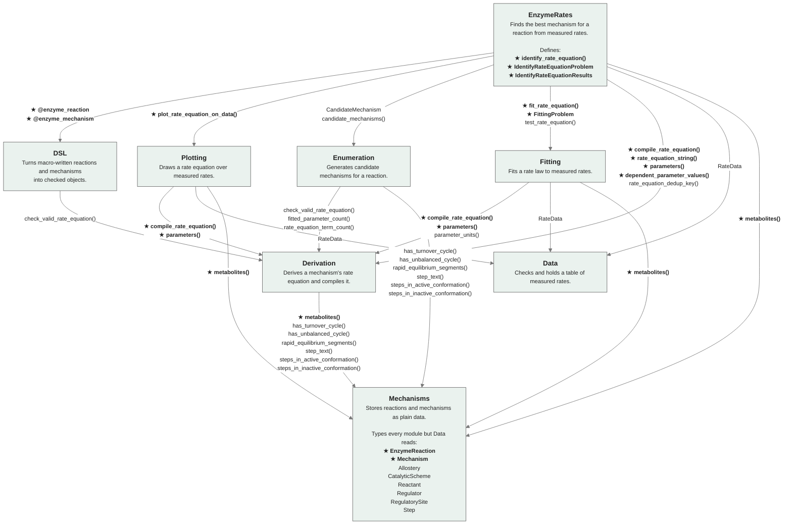

# Developer / Architecture

This page is for maintainers and contributors. It documents the internal
architecture of EnzymeRates.jl; the exported names live on the
[API Reference](@ref) page.

A mechanism is one plain value, `Mechanism`, everywhere in the package. Only its
compiled rate law has a type of its own, a **singleton callable** that drives the
compile-time derivation; the enumeration and everything else work on the plain value.
The two halves and the optimizer layer are described below.

## Modules

EnzymeRates is seven submodules and a top level. Each submodule lives in `src/<Module>/`:
`<Module>.jl` declares the module, includes its files and lists its interface in a `public`
statement. A module's public names are its interface to the other modules; only the exports
are promised to users. Its tests live in `test/<Module>/`. The diagram below shows every
exported name and every name one module takes from another, and the tables list every
module's public names; `test/test_boundaries.jl` fails when they disagree with `src/`. The
diagram is generated: each box's sentence is the first sentence of its module's docstring,
and `julia test/update_module_map.jl` rewrites it, together with the table of modules in
`.claude/CLAUDE.md`, which the same test checks.

### The module map



★ bold: exported by EnzymeRates. Arrows carry every name one module takes from another;
the Mechanisms types are listed in its box.

An arrow points from a module to a module whose names it uses. A submodule names only the
modules its arrows reach; `Mechanisms` and `Data` name none. Inside a module, code calls
its own names bare; a call into another module is qualified:
`Derivation.check_valid_rate_equation(m)`.

### What each module does

**`Data`** checks a rate table once and holds it. A `RateData` keeps the table's columns
with `Keq`, the `absolute` flag and the reference anchors; `FittingProblem` and
`IdentifyRateEquationProblem` each hold one. `Data` hides the column and anchor checks.

**`Mechanisms`** is the data model. It holds reactions (`EnzymeReaction`) and mechanisms
(`Mechanism`: a `CatalyticScheme` and its `Allostery`) as plain values whose fields any
module reads with dots. Its constructors put a mechanism in canonical form and check it,
and `show` prints a mechanism as the macro block that builds it. It hides canonical form
and the representation checks. A mechanism stores its graph and nothing derived from it;
`Mechanisms` answers the graph analyses that two modules read: the steps each
conformation runs, rapid-equilibrium segments, and turnover and unbalanced cycles.

**`Derivation`** turns a mechanism into its rate law. It decides whether the law is
defined (the guard), solves the thermodynamic constraints, names the parameters, and
derives the law with its generated code, printed text and key. It hides the King–Altman/Cha
engine, the polynomials, the joint solve and a memo that derives each mechanism once for
several questions.

**`Fitting`** fits a rate law to data. It hides the loss, the multi-start restarts, the
scaling to the reference and the call into Optimization.jl.

**`Enumeration`** proposes candidate mechanisms for a reaction (`candidate_mechanisms`):
the starting candidates identify fits first, and the children of each candidate it keeps,
each within identify's two size limits. It hides the seeds, the expansion moves, the
structural filters that prune the search and the check of the reaction's names.

**`DSL`** reads the macro language: `@enzyme_reaction`, `@enzyme_mechanism`, which
writes plain and allosteric mechanisms alike, and `parse_mechanism`, which reads a
mechanism's printed text back. It hides the parser. `@enzyme_mechanism` runs the guard,
so the DSL cannot live in `Mechanisms`.

**`Plotting`** draws a rate equation over the rates it was fitted to, with
`plot_rate_equation_on_data`. It hides the preparation of each panel: the choice of x
axis, the series, the curves and their scaling, and the labels. The package extension
`ext/EnzymeRatesMakieExt.jl`, which Julia loads with Makie, draws the panels, so loading
EnzymeRates alone never loads Makie. The extension defines
`draw_rate_equation_panels(panels; columns, figure, axis)`, which
`plot_rate_equation_on_data` calls through `Base.get_extension` with the panels it prepared.

**The top level** (`src/EnzymeRates.jl`, `src/identify_rate_equation.jl`) holds
`identify_rate_equation` and the exports. It hides the beam search, the one fit per rate
law, cross-validation and the CSV output.

### Module docstrings

The first sentence of a module's docstring is the sentence in its box of the diagram.

```@docs
EnzymeRates
EnzymeRates.Data
EnzymeRates.Mechanisms
EnzymeRates.Derivation
EnzymeRates.Fitting
EnzymeRates.Enumeration
EnzymeRates.DSL
EnzymeRates.Plotting
```

### Interfaces

Each table lists a module's public names; the top level's lists the names it defines and
exports. "Used by" names the modules that call each name, and ✓ marks a name that
`using EnzymeRates` brings in. The tests call more.

**`Data`**

| Name | What it does | Used by | Exported |
|:-----|:-------------|:--------|:---------|
| `RateData` | A checked rate table with `Keq` and its anchors | Fitting, Plotting, top level | |

**`Mechanisms`**

| Name | What it does | Used by | Exported |
|:-----|:-------------|:--------|:---------|
| `EnzymeReaction` | A reaction and its regulators | DSL, Enumeration, top level | ✓ |
| `Reactant` | A substrate or product with its atoms | DSL | |
| `Regulator` | A declared regulator with its kind and effect | DSL | |
| `Mechanism` | A catalytic scheme and its allostery, in | DSL, Derivation, | ✓ |
| | canonical form | Enumeration, Fitting, | |
| | | Plotting, top level | |
| `CatalyticScheme` | A reaction graph: metabolites, forms and steps | DSL, Derivation, | |
| | | Enumeration | |
| `Allostery` | A mechanism's allosteric states, its oligomeric | DSL, Derivation, | |
| | state and its sites | Enumeration | |
| `Step` | A step between two enzyme forms | DSL, Derivation, Enumeration | |
| `RegulatorySite` | A regulatory site | DSL, Derivation, Enumeration | |
| `metabolites` | The rate law's concentration names | Derivation, Fitting, | ✓ |
| | | Plotting, top level | |
| `step_text` | A step as the macro writes it: `E + A ⇌ EA` | Derivation, Enumeration | |
| `steps_in_active_conformation` | The steps the active conformation runs | Derivation, Enumeration | |
| `steps_in_inactive_conformation` | The steps the inactive conformation runs | Derivation, Enumeration | |
| `rapid_equilibrium_segments` | The rapid-equilibrium segments of a set of steps, and the | Derivation, Enumeration | |
| | steady-state steps between them | | |
| `has_turnover_cycle` | Whether a cycle of steps turns the reaction over | Derivation, Enumeration | |
| `has_unbalanced_cycle` | The union-find of `has_turnover_cycle` | Derivation, Enumeration | |

**`Derivation`**

| Name | What it does | Used by | Exported |
|:-----|:-------------|:--------|:---------|
| `compile_rate_equation` | The rate law as a function, allocation-free per call | Fitting, Plotting, top level | ✓ |
| `rate_equation_string` | The rate law as text | top level | ✓ |
| `parameters` | The names of the constants a fit estimates | Fitting, Plotting, top level | ✓ |
| `dependent_parameter_values` | The dependent constants' values from the fitted ones and `Keq` | top level | ✓ |
| `parameter_units` | Each fitted constant's units, as powers of the rate and concentrations | Fitting | |
| `check_valid_rate_equation` | Whether the law is defined | DSL, Enumeration | |
| `fitted_parameter_count` | The number of fitted constants, from the joint solve | Enumeration | |
| `rate_equation_term_count` | The law's term count, V×τ, before derivation | Enumeration | |
| `rate_equation_dedup_key` | The law's key: one key, one fit | top level | |

**`Fitting`**

| Name | What it does | Used by | Exported |
|:-----|:-------------|:--------|:---------|
| `FittingProblem` | A mechanism, its compiled rate law and its `RateData` | top level | ✓ |
| `fit_rate_equation` | Fits a problem with an optimizer | top level | ✓ |
| `test_rate_equation` | The loss of given parameters on a rate table | top level | |

**`Enumeration`**

| Name | What it does | Used by | Exported |
|:-----|:-------------|:--------|:---------|
| `CandidateMechanism` | A mechanism the enumerator proposes, read as `c.mechanism` | top level | |
| `candidate_mechanisms` | The starting candidates of a reaction, or a candidate's children | top level | |

**`DSL`**

| Name | What it does | Used by | Exported |
|:-----|:-------------|:--------|:---------|
| `@enzyme_reaction` | Builds an `EnzymeReaction` | top level | ✓ |
| `@enzyme_mechanism` | Builds and checks a mechanism, plain or allosteric | top level | ✓ |
| `parse_mechanism` | Reads a mechanism's printed text back | | |

**`Plotting`**

| Name | What it does | Used by | Exported |
|:-----|:-------------|:--------|:---------|
| `plot_rate_equation_on_data` | Draws a rate equation over its data, a panel per group | top level | ✓ |

**The top level**

| Name | What it does | Used by | Exported |
|:-----|:-------------|:--------|:---------|
| `IdentifyRateEquationProblem` | A reaction with its checked `RateData` | | ✓ |
| `IdentifyRateEquationResults` | The selected mechanism and the CV table | | ✓ |
| `identify_rate_equation` | Searches mechanisms, selects one by CV | | ✓ |

### The mechanism data model

Stored data is read with dots; derived data is a function. A catalytic scheme is a list
of metabolite names, a list of enzyme-form names and a list of steps. A metabolite, a form
or a step is an integer index into `c.metabolites`, `c.enzyme_forms` or `c.steps`, and a
set of steps is a `BitVector` over `c.steps`. A form's name is opaque: the scheme stores
no form contents. Code reads `m.catalytic.enzyme_forms[f]`, `m.catalytic.steps[k].from`
or `m.allosteric.allosteric_states[g]` directly, and calls a function only for a fact the
fields do not store, such as `step_text(m.catalytic, k)`.

| Type | Field | Holds |
|:-----|:------|:------|
| `Step` | `from::Int`, `to::Int` | its two forms, in its stored direction |
| | `taken_up::Vector{Int}` | the metabolites it takes up going `from → to` |
| | `given_off::Vector{Int}` | the metabolites it gives off going `from → to` |
| | `rapid_equilibrium::Bool` | whether it is at rapid equilibrium |
| | `kinetic_group::Int` | its kinetic group |
| `Mechanism` | `catalytic::CatalyticScheme` | the catalytic scheme |
| | `allosteric::Allostery` | its allostery; a plain mechanism's has no states |
| `CatalyticScheme` | `metabolites::Vector{Symbol}` | the substrates, the products, then |
| | | the modifiers, each group by name |
| | `enzyme_forms::Vector{Symbol}` | free E first, then the other forms by name |
| | `substrates::Vector{Int}` | the substrates' indices into `metabolites` |
| | `products::Vector{Int}` | the products' indices into `metabolites` |
| | `steps::Vector{Step}` | each step in the direction the graph gives, sorted |
| `Allostery` | `allosteric_states::Vector{Symbol}` | one per kinetic group: `:OnlyA`, |
| | | `:OnlyI`, `:EqualAI` or `:NonequalAI`; |
| | | empty for a plain mechanism |
| | `oligomeric_state::Int` | the number of subunits that change conformation together |
| | `regulatory_sites::Vector{RegulatorySite}` | the regulatory sites |
| `RegulatorySite` | `ligands::Vector{Symbol}` | the ligands that bind the site |
| | `multiplicity::Int` | the number of such sites |
| | `allosteric_states::Vector{Symbol}` | one allosteric state per ligand |
| `Reactant` | `name::Symbol` | the substrate's or product's name |
| | `atoms::Vector{Pair{Symbol,Int}}` | its atoms, `element => count` |
| `Regulator` | `name::Symbol` | the regulator's name |
| | `kind::Symbol` | `:allosteric` or `:competitive` |
| | `effect::Symbol` | `:activator`, `:inhibitor` or `:unspecified` |
| `EnzymeReaction` | `substrates::Vector{Reactant}` | the substrates |
| | `products::Vector{Reactant}` | the products |
| | `regulators::Vector{Regulator}` | the declared regulators |
| | `allowed_oligomeric_states::Vector{Int}` | the subunit counts to enumerate |
| | `shared_catalytic_site::Vector{Tuple{Symbol,Symbol}}` | pairs that share one site |

Each list of a step is sorted. The constructor
`CatalyticScheme(metabolites, enzyme_forms, substrates, products, steps)` takes the names
in any order and steps in either direction with kinetic group labels 1, 2, …; it puts
them in canonical form and checks them, keeping the written labels.
`Mechanism(catalytic, allosteric)` numbers the kinetic groups by their first step and moves
each allosteric state with its group, so `Allostery(allosteric_states, oligomeric_state,
sites)` takes one state per written label; a plain mechanism's `Allostery` has no states,
oligomeric state 1 and no sites. To change a mechanism, copy `m.catalytic.enzyme_forms`
and `m.catalytic.steps` with new fields and call the constructors. Never mutate a built
mechanism's vectors in place: its canonical form, hash, compiled Sig and memo entries
depend on them.

### One request through the modules

`identify_rate_equation` crosses every module on its way from a reaction to the selected
fit:

1. **The problem.** `@enzyme_reaction` (`DSL`) builds the `EnzymeReaction`
   (`Mechanisms`). `IdentifyRateEquationProblem(reaction, table, Keq)` (top level) checks
   the table into a `Data.RateData`.
2. **The starting mechanisms.** `Enumeration.candidate_mechanisms(reaction; ...)`, given
   identify's size limits and optional regulators, writes each seed as forms and steps,
   and the `Mechanism` constructor puts it in canonical form. It returns only candidates
   whose rate law is defined (`Derivation.check_valid_rate_equation(Bool, m)`) and within
   the size limits (`Derivation.rate_equation_term_count`,
   `Derivation.fitted_parameter_count`).
3. **One fit per law.** The top level asks `Derivation` three questions about each new
   candidate's mechanism: `parameters(m)` names its fitted constants,
   `rate_equation_string` prints the law, and `rate_equation_dedup_key` gives its key.
   Mechanisms with one key share one law, so one mechanism per key is fitted.
4. **The fit.** `FittingProblem` (`Fitting`) compiles that mechanism's rate law once
   (`Derivation.compile_rate_equation`), and `fit_rate_equation` fits it. The loss calls
   the compiled law on every data row at every evaluation.
5. **The beam.** The top level keeps the laws whose loss is close to the best at their
   parameter count, and `Enumeration.candidate_mechanisms(reaction, parent; ...)` proposes
   each candidate's children. Steps 3 to 5 repeat until no new law qualifies.
6. **The selection.** The top level cross-validates the best candidates at each
   parameter count: it refits each candidate once per data group, holding that group out
   (`fit_rate_equation`), and scores the fit on the held-out group (`test_rate_equation`).
   The 1-SE rule picks the result. The CSVs store each mechanism as its printed text
   (`show`), which `DSL.parse_mechanism` can read back.

### The boundary test

`test/test_boundaries.jl` parses `src/` with `Meta.parseall`, without loading the
package, and fails on:

1. a name of another module, as `Mod.name` or imported by `using`, that is not public in
   that module;
2. a module naming a module it may not depend on;
3. an underscore name in a `public` statement or used across modules;
4. an `export` in a module, which would let `using ..Mod` bring in bare names.

To use another module's function, it must be public there, under a name without an
underscore. The test also parses this page and fails when a table under
"Modules" disagrees with `src/`, naming the module and the names to add or remove.

## Derivation architecture

A mechanism's rate equation is derived once, at compile time, by the
King–Altman/Cha method in `@generated` functions (`src/Derivation/codegen.jl`).
To make that possible, `compile_rate_equation(m)` returns a **singleton callable**,
`_CompiledRateEquation{Sig}`, whose one type parameter, `Sig`, encodes the whole
mechanism in canonical form, its catalytic scheme and its allostery, as nested tuples of
Symbols, Ints and Bools (`_sig_of`), so the order or direction in which the steps were
written does not change the resulting type. The compiler
specializes the derivation per type, so the symbolic King–Altman work runs once per
mechanism and session rather than at every call. The mechanism itself is a plain value;
only its compiled law carries a type of its own.

This is the most important architectural decision in the package, and it is
deliberate. Moving the derivation to compile time leaves the compiled law,
`rate = compile_rate_equation(m)` called as `rate(conc, params, Keq)`, as straight-line
arithmetic, written in Horner form (`_horner`), that must be
**allocation-free and fast**: under 50 ns + 0.5 ns × denominator terms per call for every
gated law, including the three largest enumerated bi-bi laws (396 denominator terms each)
and three ter-bi laws (589, 799 and 858 terms).
`_testhelper_test_rate_equation_performance` (`test/Derivation/test_rate_eq_derivation.jl`)
measures each law's allocations and time per call, and the tests assert
`allocs == 0` and the law's bound. `rate_equation_string` (`src/Derivation/print.jl`)
prints the law rather than the code: each denominator term over the unit rule's normalizer,
dimensionless whenever the law has one. The compiled law's speed is the binding
constraint on the whole package: the fitter is a multi-start, global,
gradient-free optimizer that
evaluates the compiled law millions of times per fit, and a single rate equation
can take minutes to fit, so any per-call allocation or microsecond-scale
overhead would make fitting — and therefore `identify_rate_equation`, which fits
thousands of candidates — impractical.
`loss!` is held to the same standard: `FittingProblem` pre-allocates its
`log_ratios_buffer` once and `loss!` reuses it, so the inner optimization loop
allocates nothing. The cost is the flip side of the benefit: each unique
compiled law triggers a full symbolic derivation, and a mechanism with many
enzyme forms or steps can be slow to compile, exhaust memory, or `StackOverflow`.

The encoding of a mechanism in a type parameter lives in `Derivation`, behind
`compile_rate_equation`: `_sig_of` writes the Sig, and the generated methods decode it
(`_derivation_input`, `_mechanism_from_sig`) through the `Mechanisms` constructors, which
check it, so a mechanism survives the round trip unchanged. Equal mechanisms give the same
callable. Only the `@generated` methods do work per compiled law: the callable's call
runs the derivation, `parameters(rate)` runs its constraint solve, and `metabolites(rate)`
reads the names off the decoded mechanism. The decoder reads the Sig at run time, and the
package image holds it, so it compiles once for all mechanisms. Each compiled law then
pays for its generated bodies and the derivation they run, and for the methods that
specialize on it: Base's `text/plain` display and `FittingProblem` and `loss!` below. A
compiled law prints one line (`compiled rate equation`), whatever its Sig. A mechanism
prints as the macro block that builds it (`show`, `src/Mechanisms/text.jl`);
`DSL.parse_mechanism` reads that text back through the macro's walker and checks, never
evaluating it, and identify's CSVs store it with a short id (`mechanism_id`).
`FittingProblem` holds the mechanism and its compiled law, and `loss!` specializes on the
law's type on purpose: it then reads `parameters(rate)` and `metabolites(rate)` as
constants and calls the law without dispatch. The optimizer never sees that type.
`fit_rate_equation` takes its `FittingProblem` `@nospecialize` and hands
`Optimization.solve` a `FitObjective`, which holds `x -> loss!(x, fp)` behind a
`FunctionWrapper`, so every mechanism gives the solver one problem type: `solve` and the
solver compile once per optimizer, not once per mechanism.

### Parameters

The parameter interface is five calls, all in `Derivation`:

```julia
parameters(m)                                # the constants a fit estimates
parameter_units(m)                           # their units, for Fitting
dependent_parameter_values(m, params, Keq)   # the constants the law computes
rate = compile_rate_equation(m)
rate(concs, params, Keq)                     # the rate per unit enzyme
```

`parameters(m)` is exactly the names a fit's `params` holds: `Keq` is given, never fitted,
and is the last positional argument wherever it is taken, never a keyword. The law has no
enzyme concentration; a caller who wants an absolute rate multiplies by it.
`parameters(rate)` and `metabolites(rate)` give the compiled law's names as compile-time
constants, which `loss!` needs.

One type family in `src/Derivation/names.jl`, the union `_Parameter`, describes every
constant a fit estimates, and the joint solve lists them in `parameters(m)` order
(`_Solve.info`):

| Type | What it points at |
|:-----|:------------------|
| `_StepParameter(step, slot, inactive)` | Slot `slot` of step `step` of the catalytic graph, in the inactive conformation when `inactive` |
| `_RegulatorParameter(ligand, inactive)` | The constant of a regulator ligand, in the active or inactive conformation |
| `_AllostericParameter()` | The allosteric constant `L` |

A value holds no other fact and means nothing without its mechanism. At slot 1 a
`_StepParameter` is a rapid-equilibrium step's equilibrium constant or a steady-state step's
rate constant in its stored direction; at slot 2, a steady-state step's rate constant in the
reverse direction. The step's flag says which. A K on a steady-state step or a k on a
rapid-equilibrium one constructs but has no name: `_name` errors on it. `_name(p, m)`
renders the name from the step's sides and the kept member of its kinetic class, and
derives the conformation's prefix (`A_`, `I_` or none) from `inactive` and the group's or
ligand's allosteric state.
`parameters` returns these names as Symbols, and the rate law takes them at compile time.

`parameter_units(m)` gives each one's units from its step or ligand, as integer powers of
the rate and of each concentration: a steady-state step's rate constant is the rate over
what the step takes up in its direction, a binding's K what binds, any other
rapid-equilibrium K what the step gives off over what it takes up, a regulator's K its
ligand, and `L` has none. Fitting centres its search on these units and scales the
constants whose units hold the rate, so it reads no step itself.

### The joint thermodynamic solve

`_solve` (`src/Derivation/thermo.jl`) builds one integer system per mechanism
(`_joint_system`) over the columns `_constant_columns(m)` lists, each a `_StepParameter`: a
column per constant of every edge, with an inactive copy for each edge of a `:NonequalAI`,
`:OnlyA` or `:OnlyI` group; a row per fundamental cycle and conformation, and a row tying
each further member of a kinetic class to its first. The columns come ordered by
`_priority_key` (`_ordered_columns`), which reads the graph alone: the conformation
block, the step's shape (an isomerization, a step with more than one metabolite, a
binding), whether neither of its forms is free E, steady state before rapid equilibrium,
the constant that runs against the reaction, then the places of the step's forms and
metabolites in stored order (free E, then the forms by name; the metabolites in
`metabolites(m)` order), so the fitted constants do not follow the order in which steps
happen to be stored.
The solve reduces the system
exactly (`_reduce_joint_system`: `Rational{Int}`, redone in `Rational{BigInt}` on
overflow). Pivot columns are dependents. `_solve`
returns them with the independents and the fitted names as a `_Solve`, which the engine,
`parameters`, code generation and the printer read.
Columns outside a conformation's law (an `:OnlyA` edge's inactive copy, an `:OnlyI` edge's
active copy, an edge on a form that conformation cannot reach) come first, so no kept
dependent reads them. Each class is named after its member that comes last in that order
(`_kept_members`), through the `_name(p, m)` chokepoint; `_constant_columns` returns each
column's name with it, so the naming rule lives in `src/Derivation/names.jl`. A testset
in `test/Derivation/test_names.jl` walks `src/` and fails on a `Symbol("K…")`,
`Symbol("k…")`, `Symbol("V…")` or `Symbol("L…")` literal outside a parameter-name renderer,
and on a renderer outside that file. The
engine (`_law`,
`src/Derivation/engine.jl`) derives each conformation's law on a mask of the edges it
keeps (`steps_in_active_conformation(am)`, `steps_in_inactive_conformation(am)`; every
edge of a plain mechanism). Every edge keeps its stored direction, so both conformations
share the mechanism's orientation and names. The canonical form
decides the order and the direction it reads: free E is form 1 and the other forms follow
by name; each edge runs in the direction the graph gives it (`_orientation`), and a kinetic
group's edges turn with its lead (`_turn_groups_together!`). The forms' names and the
step's metabolites, not its stored place, break the priority's last ties. Constants are
named from the forms' names (`enzyme_forms`) and the names of the metabolites a step takes
up or gives off.

### The law, its code, its text and its key

`src/Derivation/poly.jl` holds sparse polynomials over integer-indexed variables (`_Poly`),
with rational exponents for constants and checked `Int64` coefficients: under the term cap
no coefficient leaves `Int64`, so an overflow is an internal error. `_law(m, s, mask)`
(`src/Derivation/engine.jl`) derives one conformation's law, `_Law`, as `v = H·Q/D`.
It contracts each rapid-equilibrium segment to a node rooted at its first form (free E roots
its own), sums the spanning trees of the segment graph, builds the numerator from each
steady-state edge's net flux, substitutes the solve, divides out `H = Π[S] − Π[P]/Keq`
exactly and brings `Q` and `D` to lowest terms in the concentrations. An MWC law
(`_AlloLaw`) holds both conformations' laws, their free-E weights over a common factor and
the regulatory sites' polynomials. `rate_equation_term_count` counts V×τ, both
conformations of an MWC law together, by a checked Bareiss determinant; the cap, which
`_law` checks, and identify's `eq_complexity_filter` read it before any polynomial is
built. `_Poly`, `_Law`
and `_AlloLaw` are mutable structs with `const` fields, never an immutable wrapper of one
reference: Julia 1.12 and 1.13 can hoist such a wrapper's box out of a loop that merges it
with another type, without a write barrier.

`_rate_body` (`src/Derivation/codegen.jl`) emits the law as straight-line locals: the
dependents in solve-column order, each segment's weight and tree sums, `Q`, `H` and the MWC
terms, all in greedy Horner form with binary `+` and `*`. Each input is read by name into a
positional local, so a `NamedTuple` in any field order works, and reciprocals and roots
(`sqrt`, or `x^(one(x)/q)`) are computed once.

`rate_equation_string` divides the law by the unit rule's normalizer (`_normalizer`,
`src/Derivation/normalize.jl`: the constant term, else Cleland's normalizer when the
denominator holds `ΠS/X` for every substrate `X` and `ΠS`, else a virtual constant term on
the first affinely independent terms), so every denominator term is dimensionless; a law
with no such normalizer prints as derived. With `coefficients = true` it prints the law in
named coefficients, and with `coefficient_values = false` without the lines that define
them. `identify_rate_equation` writes that short form to the search and LOOCV CSVs and the
full coefficient form to `best_equation.csv`.

`_canonical` (`src/Derivation/key.jl`) labels a law canonically: each part to lowest terms,
the fitted constants coloured by refinement on the term–constant incidence and
individualized while colours tie, the concentrations by name. The SHA-256 of its text is the
law's key, by which identify fits one mechanism per law and reads that fit through each
mechanism's own names (the canonical order). At 100 labellings the search stops, and the law
takes its mechanism's own key. The L-phantom certificate (`_phantom_weights`) solves exactly
for a rescaling of the other constants that absorbs `L` in a one-subunit variant whose
inactive conformation turns nothing over, and it alone decides an L phantom (`_is_phantom`).
`rate_equation_dedup_key(m)` gives identify a mechanism's key and the key of the fit it
reads: its own, or for such a variant its active law's when that law holds every fitted
constant but `L`. The variant reads that fit when a mechanism with that law was fitted in
an earlier batch or is fitted in the variant's own (`_process_batch`).

Identify asks one mechanism three questions in a row: `parameters`,
`rate_equation_string` and `rate_equation_dedup_key`. A private memo (`_Memo`,
`src/Derivation/memo.jl`) keeps the guard verdict, joint solve and law of the last
mechanism asked about, matched by `===`, so each is derived once for all three.
The memo holds one mechanism in the task's local storage, so it never grows and tasks
share nothing. A compiled law's generated methods never read it.

### Reading `Base.gc_live_bytes`

`BigInt` arithmetic raises `Base.gc_live_bytes` by bytes that no live object holds, so
the count overstates what a derivation retains. Class 3's model point (`_model_point`,
`src/Derivation/limit_test.jl`; an integer null space in `Rational{BigInt}`) raises it by
101 KiB on the six-step bi-bi ping-pong at two conformations, and a 6×6 determinant
outside the package does the same in `BigInt` and `Rational{BigInt}`, not in
`Rational{Int}`. The joint solve adds nothing: it runs in `Rational{Int}` on 10,226
enumerated bi-bi and ter-bi mechanisms without overflow. The count holds no memory and
raises no peak: a process whose count reaches 2.8 GiB peaks at 1.2 GB resident. Measure
retained memory by the resident set.

## Well-posedness guard

The guard (`src/Derivation/guard.jl`, with `limit_test.jl`, `conformations.jl`,
`admission.jl` and `messages.jl` beside it) decides whether a mechanism's rate law is the
unique fast-equilibrium limit of mass-action kinetics wherever data sit. `_guard(m)` reads
the reaction graph through masks and never constructs a mechanism. It returns an isbits
`_Verdict` (fault, limit-test verdict, face, conformation, edge), never a `Union` that a
loop reads: Julia 1.12 and 1.13 can hoist the box of a `Union` value out of a loop
without a write barrier, which corrupts the heap. `check_valid_rate_equation(m)` throws
`_guard_message(m)`, which names each step by its DSL line (`step_text`) and the face;
`check_valid_rate_equation(Bool, m)` returns the verdict instead.

The guard builds three networks (`_Network`). Two are of one catalytic subunit whose
conformations flip at free E: the **law network**, each conformation's kept steps on the
forms free E reaches through them (`steps_in_active_conformation`,
`steps_in_inactive_conformation`), and the **ε-network**, every step of both
conformations, each excluded step switched off as a **reading** says (`_Reading`,
`_eps_network`). The third is one copy of every step, each marked fast, on which the guard
checks, before any class, that every cycle of the catalytic scheme balances each
metabolite, whatever the conformations run (`_unbalanced_cycle`, the walk of
`_fast_segments` with each reactant's change less the reaction's over the step's uptake of
the first substrate): a cycle that takes up the first substrate n times net takes up each
substrate and gives off each product n times, and gives off each modifier as often as it
takes it up. Form names are opaque, so a step that leaves out a metabolite, writes one on
the wrong side or names the wrong form breaks only a cycle, and the joint solve has no law
for that cycle; the message states the cycle's net change. The faces (`_faces`) are bit
masks over the metabolite names. Class 1, a cycle that turns the reaction over
(`has_turnover_cycle`), reads no reading. Under a
reading (`_verdict_under`) the guard checks class 2, no fast cycle of the ε-network that
takes up a name net; admission's interior (`_admission_interior`: the reading is
consistent, and the active conformation still turns the reaction over); then on each face
class 3 (`_check_face`: closed classes, bottomless segments, the aggregated chains, and a
limit test modulo 2^61 − 1 where structure decides nothing) and admission's face condition
(`_admission_face`, below).

**Readings.** The steps a conformation keeps join the forms into **islands**: sets of forms
joined to each other by those steps (`exclusion_components`), neither kinetic groups nor
rapid-equilibrium segments. Every island but free E's is cut off: it lies higher in energy
and holds no enzyme of that conformation. A reading (`_SwitchOff` per step and conformation)
switches off each excluded step. One between two islands loses the rate of its uphill
direction (`_LOSES_FORWARD`, `_LOSES_REVERSE`) and keeps the other and its kind, so a
rapid-equilibrium step stays fast; at steady state it may stop instead (`_STOPPED`). One
inside an island stops at steady state, and at rapid equilibrium no reading switches it off
(`_FAST_STEP_PINNED`): its two sides lie at one energy, so thermodynamics fixes its
equilibrium constant, and a step keeps its kind in both conformations. A reading is
consistent (`_interior_verdict`) when every excluded rapid-equilibrium step loses a
direction, none stopped or left unswitched (`_CANNOT_SWITCH_OFF`), which is how a built
reading becomes inconsistent; when the steps that lose, each pointing uphill, close no
directed cycle over the islands and never point into free E's island, so energies exist that
rise along them with every cut-off island above free E's; and when they lead from free E's
island to every island, so every cut-off island has a step by which it empties. The law is
the same under every reading, since it drops the excluded steps; class 2 sees the same fast
transitions under every consistent reading, every rapid-equilibrium step's; and class 3 and
the active conformation's turnover read no reading. Only three faults of admission's face
condition, which read which transitions vanish, tell consistent readings apart
(`_FAULTS_A_READING_CHANGES`: `_FILLED`, `_PUMPED`, `_BRIDGE`).

**The search.** `_guard_with_reading` admits a mechanism under the first consistent reading
that passes every check. It tries the three built readings first (`_built_reading`, in the
order of `_SlowUptakeReading`). In each, only an excluded step that takes up one metabolite
into a cut-off form loses, toward its bound side (its affinity); every other excluded step
stops at steady state and cannot be switched off at rapid equilibrium. The steady-state
uptakes all lose their affinity; or those that lead away from free E do (their bound side's
island lies more such uptakes from free E's than their unbound side's) and the others stop;
or all stop. The built readings are cheap and decide most mechanisms. A fast cycle that
turns the reaction over under one of them is fast under every consistent reading
(`_RE_TURNOVER`), and any other fault of the first consistent one but those three holds
under every consistent reading, so either ends the guard. Next it reports an excluded
rapid-equilibrium step inside one island, which no reading switches off. Then it searches
each conformation's consistent columns (`_consistent_columns`) and every pair of them, one
column per conformation, in a fixed order, against admission's face condition alone, class 3
having passed once on the law network. When a conformation has more than
`_MAX_CHOICES_PER_CONFORMATION` (20,000) ways, or the two conformations' consistent columns
form more than `_MAX_READING_PAIRS` (5,000) pairs, the guard searches nothing, so whether it
admits never depends on the order of the steps. Such a mechanism is rejected with the first
consistent built reading's verdict, else with an active conformation that turns nothing over
(`_NO_ACTIVE_TURNOVER`), else with `_TOO_MANY_READINGS`. A rejection reports the verdict of
the first consistent reading tried, so its message never says that a step cannot be switched
off when another reading switches it off. `_guard_with_reading` returns the verdict with the
reading it was judged under, the reading the guard admits with when it admits.

**The face condition.** Admission's face condition (`_face_condition`) reads which
transitions of the ε-network are alive on a face and which vanish. It refuses, in order, a
second closed class (`_EPS_NONUNIQUE`); a filled form (`_FILLED`); a stranded basin, fed
forms outside the law network that reach it along no alive transitions that do not vanish,
entered by or holding an alive transition whose reverse is dead, or entered from outside
it and the law network (`_PUMPED`); and a bridge (`_BRIDGE`): the vanishing
transitions of a conformation shorten the cheapest spanning in-tree of the fed forms
(`_fewest_slow`) where no potential absorbs their turnover, or both conformations' do
together.

The filling check (`_FILLED`) looks, on a face, at each rapid-equilibrium transition that
vanishes and is alive while its reverse, which does not vanish, is dead. It refuses one
when:

- free E reaches its source on that face;
- alive rapid-equilibrium transitions, vanishing or not, lead from the law's forms to that
  source (`_fast_law_reach`); and
- no alive rapid-equilibrium transitions that do not vanish lead from its target to a law
  form.

A form's weight is its inflow over its outflow. Past a slow transition the inflow is bounded
by a rate that vanishes; through fast transitions alone it grows with their speed, and then
only an outflow that grows as fast keeps the form empty in every order of the two limits. A
step that loses a direction can keep its uptake, which dies on the face where its metabolite
is zero and leaves the vanishing direction to fill the form one way. A built reading never
does this: the direction it keeps is a release, alive on every face. A steady-state
transition that fills one way is the stranded basin's case.

The set-aside rule (`_without_set_aside_groups`): a face refused as a bridge passes when the
condition finds no fault once more without the groups that cannot matter there. A face
refused for a pumped basin is not run again, since that basin cannot drain and is never set
aside. A group is the cut-off forms free E reaches on the face that alive transitions join,
with every transition at them. It is set aside when the law's forms it touches lie in one
set that the law's own rapid-equilibrium steps, alive both ways, hold in equilibrium (one
touching form counts); when its fast classes drain to the law's forms however fast the
rapid-equilibrium steps are (`_aggregated_chain` on the alive transitions that do not
vanish; a slow way out of a form that the fast steps carry elsewhere does not count, its
share vanishing as they speed up); and when each of its transition pairs is safe: alive
both ways; or alive only in the direction that does not vanish, so it only empties its
form; or joining two cut-off forms, alive only in the direction that vanishes, which is
slow, or leaves a form the law does not reach along alive rapid-equilibrium transitions, or
enters one that reaches the law along alive rapid-equilibrium transitions that do not
vanish. A cut-off form free E does not reach on the face, all of whose alive transitions
lead into the groups set aside, goes with them, or it would read as a second closed class.
A second route between two forms already in equilibrium changes nothing, and with one
touching form there is no route between two forms. The group's own weight vanishes: every
form drains at a rate that does not shrink as the fast steps speed up, none fills faster
than it empties, and class 2 has refused any fast cycle in it that turns the reaction over.

Neither argument proves that the face condition with these checks suffices under every
reading; the evidence is numerical. A gate ran the guard on 78,554 mechanisms in ten
populations, and the ε-path and RE-speed oracles on those that only the search or the
set-aside rule admits: each of the 591 of 8 steps or fewer agrees along corner directions,
and samples of the larger ones agree too. With the filling check off, the guard admits 96
more mechanisms of 8 steps or fewer among the `:OnlyA` taggings of the uni-uni, bi-bi and
ping-pong starting mechanisms, and 18 of them fail. `test/Derivation/test_admission.jl`
keeps a sampled population test with corner directions ("sampled taggings: the
energy-level rule agrees with the oracles").

**Faults.** A verdict's fault is one of: two constants of the law share a name, which the
guard checks first (`_SHARED_NAME`, `_shared_constant_names`); a cycle does not balance a
metabolite (`_UNBALANCED_CYCLE`); no cycle turns the reaction over (`_NO_CYCLE`); a fast
cycle does (`_RE_TURNOVER`); on a face, class 3's `_NONUNIQUE`,
`_BOTTOMLESS`, `_TRAP`, `_SPLIT`, `_LAW_MULTI` or `_MULTILEVEL`; an excluded
rapid-equilibrium step inside one island (`_FAST_STEP_PINNED`); an active conformation that
turns nothing over (`_NO_ACTIVE_TURNOVER`); on a face, admission's `_EPS_NONUNIQUE`,
`_FILLED`, `_PUMPED` or `_BRIDGE`; or too many readings to search with no consistent built
reading (`_TOO_MANY_READINGS`). An inconsistent reading is never reported.
`_admission_message` writes the admission faults' text and offers each fix whose variant
passes the guard: for the pinned step, its group made steady-state, or the steps that join
its sides tagged `:OnlyA` (`:OnlyI` in the active conformation).

On a mechanism the guard rejects, the macro, the parser and the derivation entries throw;
`init_mechanisms`, `seed_mechanisms` and both methods of `Enumeration.candidate_mechanisms`
drop it. The flip move runs the guard on each candidate it builds, the split move on each
candidate whose count rises, and the tagging move on each tag set its base search tries.

## Enumeration engine architecture

Mechanism enumeration works on the plain value `Mechanism` (`src/Mechanisms/types.jl`),
inside candidates (below): a `CatalyticScheme` and its `Allostery`. A `CatalyticScheme` is a
reaction graph in canonical form: its `metabolites` by name (the substrates, then the
products, then the modifiers, each sorted), its `substrates` and `products` as indices into
them, its `enzyme_forms` by name (free E first, then sorted), and its `steps` (`Step`: two
form indices, the sorted indices of the metabolites the step takes up and gives off, its
rapid-equilibrium flag and its kinetic group). A form's name is opaque: the graph stores no
form contents, so a reactant bound where it does not react is the reactant taken up, and
only the forms' names tell the two bindings apart (`ESSmod` beside `ES`). It holds no
reaction, and `==` and `hash` read these fields alone, alike in every process. An
`Allostery` holds one allosteric state per kinetic group (none for a plain mechanism), the
oligomeric state and the regulatory sites. Every module reads these fields with dots (see
[The mechanism data model](@ref)).

The macro, the parser and the enumeration build a mechanism from names and steps.
`CatalyticScheme(metabolites, enzyme_forms, substrates, products, steps)` takes the names in
any order and each step in either direction with its kinetic group label (1, 2, …, each
used), builds the canonical graph (`_canonical`) and checks it;
`Mechanism(catalytic, Allostery(allosteric_states, oligomeric_state, sites))` takes the
state of each written group label. The enumeration works on candidates
(`CandidateMechanism`): a mechanism and its own record of each form (`_FormRecord`,
`src/Enumeration/record.jl`: the form's conformation label, the names it binds
productively and as modifier copies, and its residual). The enumerator owns the naming
rule (`_form_name`): it names each form from its record, `EAB` for E with A and B bound,
`ESSmod` for ES with a second S bound where it does not react, `E_res_plusA_minusP` for a
covalent intermediate after A bound and P left. Its moves read a form's contents from the
record alone, and tell a step that binds a modifier copy from one that binds the reactant
by the difference between its two forms' records. The seeds write their topologies, dead
ends and bases as records and steps; the moves copy a parent's records and steps with new
flags, groups or bound inhibitors (`_regrouped`, `_with_flags`, `_dead_end_graph`). One
function, `_candidate`, names the forms and builds every candidate, the only place in
`Enumeration` that calls a mechanism constructor; it keeps the records in the order of the
built mechanism's forms. The moves that tag a mechanism or change its regulatory sites
compose the parent's catalytic scheme with other states or sites,
`Mechanism(parent.catalytic, Allostery(states, oligomeric_state, sites))`, which runs only
the state and site checks. Going `from → to`, a step takes up the metabolites in
`taken_up` and gives off those in `given_off`. A binding takes up exactly one metabolite
and gives off none (`_is_binding`). The enumerator calls it plain when its target's record
is its source's with that metabolite added, the residual unchanged and the conformation
free to change (`_is_plain_binding`), and fused otherwise, as when the last substrate binds
straight into the product-bound form (`EA + B → EPQ`). An isomerization takes up and gives
off nothing (`_is_iso`); a Theorell–Chance step takes up one metabolite and gives off
another. The allosteric moves (`_chemistry_groups`) and `_merged_complexes` tell catalysis
from binding by the records of a step's two forms (`_is_plain_binding`); the derivation and
the guard read no form contents, and tell a step's shape from its lists. The derivation
reads every binding alike, so a fused binding's rapid-equilibrium constant is a
dissociation constant and its steady-state pair a binding and a release rate constant.
Every step's constants are named by the two sides of its kinetic class's kept member —
each side's enzyme form followed by its free metabolites (`K_ES_to_E_S` for
`E + S ⇌ ES`, `K_EPQ_to_EA_B` for `EA + B ⇌ EPQ`, `k_EA_B_to_EQ_P` for
`EA + B <--> EQ + P`).

Like the compiled laws, the graph is canonical, so the order or direction in which steps are
written does not change the resulting mechanism. The canonical form is load-bearing:
deduplication by `==` and `hash` works only because construction is canonical, and every
constant is named after the stored sides of its class's kept member, so do not relax or
reorder it. `_canonical` stores the metabolites as substrates, products and modifiers, each
by name, free E first and the other forms by name, and stores every edge in the direction
the graph gives it (`_orientation`), reading only the edges, the forms' names, the
substrates and the products: an edge that only takes up or only gives off metabolites runs
as the uptake, so a release is stored as the binding it reverses; one that takes up some and
gives off others runs the way that takes up more substrates and gives off more products; an
isomerization, or an exchange of one modifier for another, runs the way the shortest cycle
through it that turns the reaction over runs (`_turnover_directions!`, a breadth-first
search over a form and the net uptake of the first substrate, which finds the shortest
closed walk); failing that, away from free E, and failing that from the form whose name
comes first, free E before every other, so that a direction follows the forms' names and not
the order they are stored in. It sorts the edges, and `Mechanism` numbers the kinetic groups
by their first edge. The edges of one group share their constants, so they turn together
after the member nearest free E among those the first three rules decide, ties broken by the
forms' names (`_turn_groups_together!`): an edge with metabolites takes up what that member
takes up, and an isomerization keeps the direction it was written in relative to it. In
`(Estar <--> E, EstarA <--> EA)` the reaction runs through the two edges in opposite
directions, so nothing in the graph says how the members correspond: the writer aligns the
group, as the enumerator does, and turning one isomerization against its group writes
another mechanism. The `RegulatorySite` constructor sorts a site's ligands by name, and the
`Mechanism` constructor sorts the sites.

The constructors check representation only (`_check_written` and `_check_graph`, and for an
allosteric mechanism `_check_tags` and `_check_ligands`): indices in range; names a
metabolite can take, each declared once, and no form named like a metabolite; a form named
`E`, and edges that join every form to it; every declared name taken up, given off or bound
by some step. They also enforce the kinetic-group rules. A group's edges take up and give
off the same entries and carry one RE/SS flag (`_check_uniform_groups`), so a fused and a
plain binding of one metabolite may share a group and a Theorell–Chance step cannot share
one with a binding. A reaction — the pair of an edge's two sides — appears in one edge
(`_check_each_reaction_once`). Form names are opaque, so two of them can render one constant
name, as a form named `ES_I` and the side `ES + I` do; the guard rejects such a mechanism
(`_shared_constant_names`). The enumerator, which names the forms it builds from their
contents, refuses a reaction whose names spell one string two ways, such as `NAD`, `P` and
`NADP` (`_check_decodable_names`, run by `candidate_mechanisms`). Whether a mechanism's rate
law is defined is the well-posedness guard's question (`src/Derivation/guard.jl`; see
[Well-posedness guard](@ref)). The macro, the parser and every derivation entry throw on a
mechanism it rejects (`check_valid_rate_equation`), and the enumerator's exits and its flip,
split and tagging searches drop one (`check_valid_rate_equation(Bool, m)`). The constructors
and the Sig decoder do not run it. Those exits and searches test a candidate with
`_enumerator_keeps`, which also drops an allosteric mechanism the guard admits in which a
conformation keeps a form, other than free E, that only bindings it excludes enter
(`_kept_forms_keep_a_binding`): its law is the limit, so a user may write it, but the
enumerator does not propose it.

These are ordinary value types to avoid excessive precompilation costs. The enumeration
builds, expands, and deduplicates many thousands of candidate mechanisms (see
[The enumeration engine](@ref)). If each candidate were a singleton parametric type, merely
constructing it would trigger compiler specialization — the same precompilation cost the
derivation pays — multiplied across thousands of mechanisms, which would be prohibitive.
Carrying mechanism structure as runtime values instead means enumeration and deduplication
cost no compilation at all. Only the candidates the search actually fits have their rate
laws compiled, one at a time, through `compile_rate_equation`.

The moves never emit a child that is provably a reparameterization of its parent. The
split move divides a group by binding context and accepts a set of splits only if the
independent-parameter count rises and the guard accepts the built child; the count comes
from the joint solve (`fitted_parameter_count`), which derives no rate polynomial. A
split never changes admission's interior verdict, since both parts keep the group's tag. A
set whose child the guard rejects counts as failed, like one whose count does not rise,
and the search extends a failed set by the splits of the groups that share its
rapid-equilibrium segments. The RE→SS move flips whole groups and
accepts a set only if the rapid-equilibrium segment count rises and every flipped group
carries net flux in the child. In a plain mechanism it never offers as a unit a flank
of a qualifying chain whose isomerization is steady state (`_chain_flank_groups`):
by the chain lemma that flip adds parameters and no rate law. An
allosteric mechanism keeps those flips, since over more than one catalytic
subunit a flank's flip can raise the rank. Flux is decided on the graph of
rapid-equilibrium segments (`_flux_carrying_groups`): each steady-state step is an
edge weighted by
its net uptake of substrates minus products, segment offsets included, and a step
carries flux exactly when its biconnected block holds a cycle of nonzero weight. A
steady-state group with no such step exposes only the ratio of its constants, so a
flip set that leaves one counts as failed and is extended, and a split part with
none is emitted at rapid equilibrium. A dead-end copy of a substrate or product
is redundant, and never emitted, when in every conformation where it binds each of
its complexes has a productive twin (a form that holds no modifier, in
the complex's rapid-equilibrium segment with its offsets, so the two weights are
proportional: `_productive_twin`, tested over a group by `_all_twin`; every
conformation holds its free enzyme, `_redundant_copy_groups`), and the dwell gauge,
which rescales each twin by
its own factor and all of the copy's complexes by one factor, is consistent with
every kinetic group's shared constants, the copy's own included, an `:EqualAI`
group taking one rescaling in both conformations (`_gauge_rescaling`, bookkeeping
over the edges whose classes, `_GaugeClass`, are a kinetic group's or a twin form's own,
per conformation); a copy whose complexes all have twins but whose gauge fails is
kept, since only the gauge proves the copy's constant invisible. The
dead-end move skips a redundant placement, the split drops every child that holds
a redundant copy group (a split can complete a gauge, and splitting a group that
forms a copy's twins can break one, so only the whole child decides), and
`_expand_change_allo_state` and the parent check reject a redundant group
(`_redundant_copy_groups`). A complex
that duplicates only a copy's complex never rejects, since the sites that pin
either copy may keep both constants separable.
`candidate_mechanisms` asserts both rules on every parent (`_assert_emission_rules`).
Both refinement moves share one minimal-set search (`_minimal_gaining_sets`).
Duplicate laws that survive these proofs share one fit, an L phantom's key aside:
identify fits one mechanism per key (`_canonical`, `src/Derivation/key.jl`). A numerical
identifiability rank exists only in the test suite, as an oracle for the proofs and the
L-phantom certificate; nothing in `src/` estimates identifiability numerically.

`init_mechanisms` appends to the seeds their merged and Theorell–Chance variants
(`_seed_variants`, plain `Mechanism`s only). `_merge_isomerization` removes a
chemistry isomerization and moves every other step at its substrate side onto its
product side, so the last substrate's binding becomes fused; `_eliminate_form`
replaces a form whose only two steps are bindings into it by one Theorell–Chance
step in a group of its own. Every step of a base starts at rapid equilibrium. The
variants are the inclusion-minimal sets of the base's flux-carrying groups
(`_minimal_flips`) whose flip to steady state leaves no rapid-equilibrium
turnover cycle (`has_turnover_cycle`: a cycle of RE steps whose net uptake of the
first substrate is nonzero),
keeps a maximal rate both ways (`_has_vmax`, condition V), keeps chemistry out of
equilibrium with both sides (`_chemistry_equilibrates_both_sides`, condition C),
passes the guard and keeps every steady-state group flux-carrying.
`_seed_candidate_screen` runs the first three tests on index arrays with a
weighted union-find, so the other two run only on a candidate that passes them. A
merged variant whose every merged complex has two steady-state steps, each alone
in its group, has the family of the unmerged chain with rapid-equilibrium flanks
at the same count and is skipped. `_degenerate`, the failure of V or C on the
active-state graph, marks the starting mechanisms that `candidate_mechanisms`
(`src/Enumeration/seeds.jl`, `_base_tier`) replaces by their flip children that are not
degenerate. Both methods of `candidate_mechanisms` return a `CandidateMechanism` for each
mechanism within the two size limits, which they apply to what they return and never
inside a move's own search.

`_requires_hyperbolic_catalysis` is true for a mechanism whose oligomeric state is
above 1, and the moves
that can give such a mechanism a non-hyperbolic catalytic scheme consult
`_hyperbolic_catalysis`: `_expand_to_allosteric` promotes a non-hyperbolic
parent at oligomeric state 1 only, and above one subunit the tagging and change-tag
moves (`_expand_to_allosteric`, `_expand_change_allo_state`), like the flip move
(`_expand_re_to_ss`), drop a child that fails the predicate. On an
allosteric mechanism the predicate reads each conformation's law
(`steps_in_active_conformation`, `steps_in_inactive_conformation`), since a conformation
that runs part of the catalytic graph can carry a power the whole graph lacks. The
predicate scores the rapid-equilibrium segment graph of the catalytic scheme, leaving out
every edge that touches a form holding a modifier, a reactant's modifier copy included: for
each substrate and product, a directed steady-state edge scores one if it binds the
metabolite in that direction plus the count the edge's source form carries beyond its
segment's bottom form (the offsets of `rapid_equilibrium_segments`), and a segment scores
the most any of its forms carries. The equation's degree in the
metabolite is the best score over root segments and spanning arborescences toward
the root; the predicate decides "at most 1" with reachability checks
(`_all_reach`) rather than a max-arborescence solve, since a weight-2 pattern is
one segment or edge scoring 2, a scoring root plus a compatible scoring edge, or
two compatible scoring edges. The exactness of the predicate against the derived
denominator is pinned by a test over the uni-bi enumeration and the
ping-pong-capable bi-bi enumeration, which contains every bi-bi mechanism. A future
conformational type (KNF, mnemonic, slow isomerization) adds one
`_requires_hyperbolic_catalysis` method and calls the predicate in its promotion
move.

`test/Enumeration/test_mechanism_enumeration.jl` bounds the memory the enumeration holds
and allocates: the bytes each candidate of the bi-bi starting set holds
(`Base.summarysize`), the bytes the bi-bi starting set and one expansion allocate, and the
bytes the ter-ter `init_mechanisms` call allocates. A field derived from the steps and
stored on `Mechanism`, `Step` or a candidate's record raises the first; more work per
candidate raises the others. The macOS CI runner has 7 GiB, and its tests slowed by tens
of minutes when each mechanism stored such facts. Time and peak resident memory depend on
the machine and its collector: the ter-ter testset logs both, and bounds only the time
outside garbage collection.

## Optimization algorithm architecture

Fitting reaches solvers only through Optimization.jl; the package ships no solver of
its own. `fit_rate_equation` (`src/Fitting/fit_rate_equation.jl`) builds an
`OptimizationProblem` whose objective, `_fit_loss`, scores each point with `loss!`
through a `FitObjective` (see [Derivation architecture](@ref)), and calls
`Optimization.solve` with whatever optimizer the caller passes. This gives the
package access to the global, gradient-free optimizers that non-convex
rate-equation fitting needs — CMA-ES (`OptimizationCMAEvolutionStrategy`) and
BBO differential evolution (`OptimizationBBO`) are the tested choices — without
taking on a solver dependency or locking users into one algorithm. Optimization.jl
common options (`maxtime`, `maxiters`, …) are named keyword arguments, and
solver-specific options pass through a `solver_kwargs` named tuple; see
[Loss & optimizers](@ref) for the user-facing view.

### What a fit costs

A fit costs `n_restarts` × evaluations per restart × table rows × time per row, plus
compiling the law once and the solver's own work. The tables below come from 118 laws
sampled from the 2026-11-02 searches, 59 from each, each fitted once, cold, with 20 restarts
on one aarch64 core on Julia 1.13.3. A benchmark copy of `_fit_loss` counted the
evaluations, and `loss!` was timed alone on parameter sets from that fit:

| Median (range) | PGK, 386 rows | PFKP, 486 rows |
|:---------------|--------------:|---------------:|
| Evaluations per restart | 2,830 (1,160–22,900) | 6,230 (2,820–30,100) |
| Evaluations per fit | 56,700 (23,300–458,000) | 125,000 (56,500–601,000) |
| `loss!` per call | 3.3 µs (2.8–18.3) | 6.3 µs (5.1–8.9) |
| `loss!` per row | 8.5 ns (7.2–47) | 13 ns (10–18) |
| Warm time per restart | 0.014 s (0.004–0.27) | 0.050 s (0.020–0.34) |
| Whole fit | 0.38 s (0.18–5.6) | 1.12 s (0.51–7.0) |
| Warm fit ÷ (evaluations × `loss!`) | 1.28 (1.08–1.54) | 1.25 (1.12–1.43) |
| Compiling the law | 0.11 s (0.07–0.22) | 0.12 s (0.12–0.19) |
| Compile share of a fit | 28% (3–54) | 11% (3–23) |

Over all the sampled time, which large laws dominate, a fit divides as follows:

| Search | Mean fit | `loss!` | Compiling the law | Solver and the rest |
|:-------|---------:|--------:|------------------:|--------------------:|
| PGK | 1.05 s | 75% | 11.5% | 13.5% |
| PFKP | 1.41 s | 71% | 9% | 20% |

`loss!` costs about the same inside a fit as alone, so a warm fit is close to evaluations ×
`loss!` time plus 1.5–1.8 µs per evaluation. A profile of warm fits puts the objective at
77–92% of their time, CMA-ES's eigendecomposition (`MEigen`, in CMAEvolutionStrategy) at
5–14% and garbage collection at 1–5%. The objective's wrapper costs too little to measure,
and the package's own work around the solver stays near 1%. Compiling takes 0.10–0.19 s per
law whatever its size, so it reaches 30–50% of a fit on PGK's laws of 6–8 parameters and
under 5% on the largest laws. `test/Fitting/test_fitting.jl` bounds a fit's time by its
counted `loss!` calls.

The table gives `loss!` in ns per row on the PFK table (486 rows) and the PGK table (386
rows), for the same laws at each version. The PFKP columns are one allosteric law each. The
PGK columns are means over 60 laws drawn from those whose loss no other fit shares; 6 are
allosteric and 54 plain, although allosteric laws made up 55% of the search's fits, because
an allosteric law often repeats the loss of a plain one. Dependencies match the 0.10.0
cluster run; the machine is one aarch64 core on Julia 1.13.3.

| Version | PFKP, 13 params | PFKP, 20 params | PGK, allosteric | PGK, plain |
|:--------|----------------:|----------------:|----------------:|-----------:|
| 0.8.0 | 1,065 | 1,107 | 738 | 87 |
| 0.9.0 (#83) | 39 | 77 | 88 | 90 |
| #85 (Horner form) | 39 | 76 | 37 | 29 |
| 0.10.0 at `663501af` | 11 | 21 | 17 | 17 |

Three changes account for the gain:

- **Run-time dispatch in `loss!`.** At 0.8.0, `rate_equation` took about 41 ns on the
  13-parameter PFKP law and allocated nothing, while `loss!` took about 1,000 ns per row and
  allocated 778 KB per call. `metabolites` of an allosteric mechanism splatted a `Vector`
  into its result, so the compiler inferred
  `Tuple{Symbol, Symbol, Symbol, Symbol, Vararg{Symbol}}` with or without regulators. Each
  row then dispatched `ntuple`, `rate_equation`, `sign` and `log` at run time. Plain
  mechanisms never paid this cost. Every PFKP fit was allosteric, as were 55% of PGK's fits,
  which took 97% of the fit time in a random sample. 0.9.0 gave `metabolites` a fixed
  length.
- **Horner form.** PGK's laws run 2–3× faster, because the form removes multiplications.
  PFKP's smaller laws gain nothing. The generated code emits no `muladd`, and Julia does not
  contract `x * y + z` by itself, so it executes no fused multiply-adds.
- **The one law engine (#95).** Nearly all of the further 1.7–3.6× arrives in this
  commit; #91 and #92 change nothing, and #93 helps only the 13-parameter PFKP law, from 36
  to 27 ns. Before #95, an MWC law called Julia's general integer power (`pow_body`) for
  each `x^n`, at about 2 ns a call: 7 calls per evaluation on the 13-parameter PFKP law and
  20 on the 20-parameter law. #95 writes these powers as multiplications, which takes those
  laws from 27 to 11 and from 64 to 20 ns per row. Laws also lose operations: from #92 to
  0.10.0, the 13-parameter plain PGK law falls from 460 to 312 multiplications and from 317
  to 150 additions.

The fit counts changed far less, and the losses agree: 89% of PFKP's and 87% of PGK's fits
at 0.10.0 pair with a fit at 0.8.0 of equal parameter count within a relative loss of 10⁻⁸.
These pairs match values, not verified mechanism identities.

|  | PFKP | PGK |
|:-|-----:|----:|
| Fits, 0.8.0 → 0.10.0 | 132,836 → 119,453 | 18,677 → 15,700 |
| Seconds per fit on one core, 0.8.0 → 0.10.0 | 162 → 2.7 | 37.5 → 1.4 |
| Speedup per fit on one core (95% interval) | 60× (49–73) | 27× (17–41) |
| Cluster wall time, 0.8.0 → 0.10.0 | ≥ 24 h → 62 min | 112 → 13.3 min |
| Cluster core-seconds per fit, 0.8.0 → 0.10.0 | ≥ 614 → 25 | 277 → 40 |

Each one-core mean comes from a random sample of the run's fits: 40 PFKP and 80 PGK at
0.8.0, 120 of each at 0.10.0. Cluster core-seconds are wall time × workers ÷ fits, so they
include startup, enumeration, cross-validation and idle workers. The 0.8.0 PFKP run reached
its 24 h limit during cross-validation, so its figure is a lower bound.

These one-core means predate #99, which changes each fit's search box; the sample
above, with #99, gives 1.41 and 1.05 s. How much of that gap #99 causes is not separated.

The cluster gained less than a single core did: at least 25× and 7× per fit, because workers
now wait for much of a run. In `sacct`, the average worker of the 0.10.0 runs used the CPU
for 42:47 of 61:18 on PFKP (70%) and 3:16 of 13:01 on PGK (25%), which comes to 17 and 10
CPU-seconds per fit. Workers connected within 15 s, and the master's CPU accounts for at
most 8.5 of PFKP's 18.5 idle minutes and 2.1 of PGK's 9.8. The rest is not measured, because
`progress.log` carries no timestamps. How those 17 and 10 CPU-seconds divide between the fit
itself, slower or contended cores, enumeration, cross-validation and message passing is also
not measured; a fit alone takes 1–3 s on the one-core benchmark machine.

The compiled law's own time cannot show a slow `loss!`, and `@inferred loss!` passes on
these slow paths, since the result is a `Float64` either way. So the speed gate in
`test/Derivation/test_rate_eq_derivation.jl` also measures `loss!` on each of its laws: no
allocation in relative or absolute mode, and time per row at most 1.25 times the compiled
law's time per call plus 8 `log` calls, timed in one process so machine speed cancels out.
The bound holds if any of 20 batches meets it, each on a new `FittingProblem`, because time
on one problem can sit up to about 40% above a new problem's. The factor of 1.25 covers a
slowdown of unknown cause that once hit three laws in one process, which the batches cannot
cure. Eight `log` calls leave room for the coverage counters on `loss!`'s own lines in CI
jobs. The compiled law itself must stay under 50 ns + 0.5 ns per denominator term. That
bound tolerates the spread between machines: small laws take 1-8 ns on an aarch64
development machine and 5-38 ns on CI, varying by runner. So a moderate slowdown of a small
law passes it.

`test/Fitting/test_fitting.jl` checks `loss!` on each column type a table can bring and on a
cross-validation fold. `RateData` stores `Rate` and each metabolite as a `Vector{Float64}`,
because an abstract column type costs a run-time dispatch on each read.

`test/test_type_stability.jl` requires JET's optimization analysis to report nothing on
every exported and public function and on the workers' internal functions, on Julia 1.13
only, since inference changes between versions. Each row reads as a call and says whether it
must be free of dispatch (`@_testhelper_no_dispatch`) or may dispatch only for named reasons
(`@_testhelper_dispatches_in`), and a row that stops needing a reason fails. A public
function with no row fails the test; a public type does not, so deleting the row of
`FittingProblem`, `RateData` or `Mechanism` would pass. Five limits apply:

- JET does not look past a run-time dispatch or into a `pmap` closure, so the bodies the
  workers run have rows of their own.
- JET gives a report in a shared callee once per row, so an exempt function that reaches it
  first hides it from other functions.
- The test drops a report below a call that cannot compile, which mostly describes code that
  never runs at those types, and a report through `Base.slowlock`, which is not package
  code. A `@nospecialize` body is therefore checked only at the concrete types its rows
  name, and at the abstract signature that actually compiles, which has rows of its own
  (`fit_rate_equation` on an abstract `FittingProblem`, `_scale_rate_constants` on a
  mechanism of type `Any`).
- JET misses a dynamic call written directly in the body of a comprehension or generator
  whose result is untyped, such as `[(r[] + x)::Float64 for x in v]` with `r::Ref{Any}`. It
  does report the same call with a typed result (`Float64[...]`), in an explicit loop, or in
  a callee the comprehension calls.
- JET misses a single dynamic call in the body of a `@generated` function, so the allocation
  and time bounds above stay the hard guard on the compiled law.
